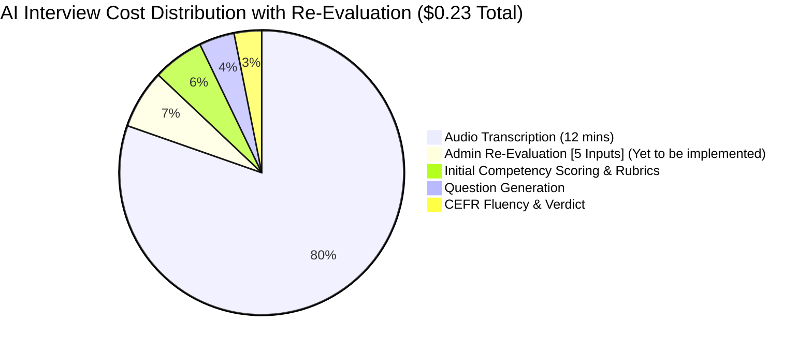
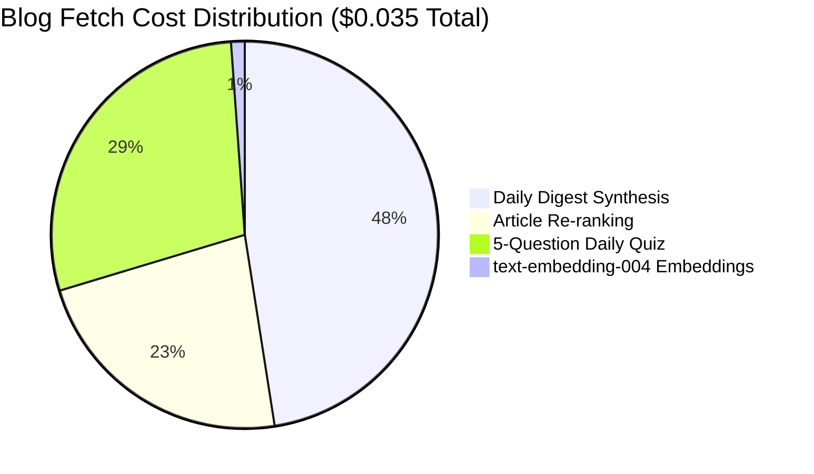
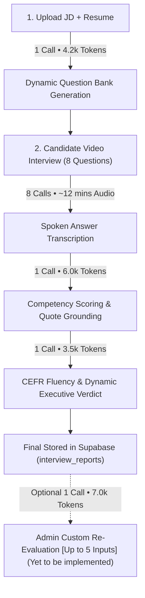
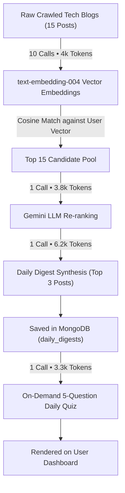

# Gemini AI Usage, Token Lifecycle & Cost Analysis

This document provides a refined, standalone technical audit of **Google Gemini API** usage for the **AI Interview Module** and the **Blog Fetch & Synthesis Module**, reflecting the replacement of the conversational Copilot with the **On-Demand Admin Re-Evaluation** feature (flagged as *Yet to be implemented*).

---

## 1. Unified Model Matrix (`gemini-3.1-pro-preview`)

| Module Name | All Tasks Handled | The Single Model | Total Usage & Cost |
| :--- | :--- | :--- | :--- |
| **AI Interview Module** | • Spoken Audio Transcription • Dynamic Question Bank Generation • Candidate Competency & Rubric Scoring • CEFR English Fluency Assessment • Dynamic Executive Verdict • **Admin Custom Re-Evaluation** *(Yet to be implemented)* | `gemini-3.1-pro-preview` | **Per 1 Candidate Interview** • **12 API Calls** *(13 if Re-Evaluated)* • **~20,000 Text Tokens** • **~12 Minutes Audio** **Est. Cost: ~$0.22 – $0.24** |
| **Blog Fetch & Synthesis Module** | • Scraped Article Re-ranking • Daily Digest Synthesis & Takeaways • Executive Briefing Generation • Daily Knowledge Quiz Generation *(Vector Math: `text-embedding-004`)* | `gemini-3.1-pro-preview` + `text-embedding-004` | **Per 1 User Daily Cycle** • **13 API Calls** • **~17,300 Tokens** **Est. Cost: ~$0.035 – $0.045** |

---

## 2. Token & Cost Distribution Chart

### Per Candidate Interview Cost Breakdown ($0.23 Total)

### Per User Blog Fetch Daily Cycle Cost Breakdown ($0.035 Total)

---

## 3. End-to-End Cycle: AI Interview Module (Per 1 Candidate)

> **Admin Custom Re-Evaluation (Yet to be implemented)**: Re-assesses candidate text transcripts in 1 single API call against up to 5 custom criteria provided by the admin, generating an updated scorecard and targeted verdict.

### Step-by-Step Call & Token Audit:

| Step | Action | Input Units | Output Units | Est. Cost (`gemini-3.1-pro-preview`) |
| :---: | :--- | :--- | :--- | :---: |
| **1** | **Question Generation** (1 call) | 3,000 tokens (JD + Resume) | 1,200 tokens (8 structured questions) | **$0.009** |
| **2** | **Audio Transcription** (8 calls) | ~12 mins audio (candidate answers) | 2,000 text tokens (transcripts) | **$0.180** |
| **3** | **Competency Scoring** (1 call) | 4,500 tokens (answers + rubrics) | 1,500 tokens (scores + quotes) | **$0.013** |
| **4** | **CEFR Fluency & Verdict** (1 call) | 2,800 tokens (transcripts + grammar) | 700 tokens (headline + summary) | **$0.007** |
| **5** | **Admin Custom Re-Evaluation** (1 call) *(Yet to be implemented — up to 5 inputs)* | 5,200 tokens (transcripts + 5 criteria) | 1,800 tokens (new scores & summary) | **$0.015** |
| **Total** | **Full Candidate Lifecycle (with Re-Evaluation)** | **~15,500 In + 12m Audio** | **~7,200 Out Tokens** | **~$0.224** |

*(Note: If the admin does not trigger a re-evaluation, the total interview cost is **~$0.209**).*

---

## 4. End-to-End Cycle: Blog Fetch Module (Per 1 User Daily Cycle)

### Step-by-Step Call & Token Audit:

| Step | Action | Input Units | Output Units | Est. Cost |
| :---: | :--- | :--- | :--- | :---: |
| **1** | **Vector Embeddings** (10 calls) | 4,000 tokens (`text-embedding-004`) | 768-dim vectors | **$0.0003** |
| **2** | **Article Re-ranking** (1 call) | 3,500 tokens (15 summaries) | 300 tokens (JSON ranked IDs) | **$0.0060** |
| **3** | **Digest Synthesis** (1 call) | 5,000 tokens (top 3 full articles) | 1,200 tokens (takeaways & synthesis) | **$0.0125** |
| **4** | **Daily Knowledge Quiz** (1 call) | 2,500 tokens (digest context) | 800 tokens (5 vetted questions) | **$0.0075** |
| **Total** | **1 User Daily Digest Cycle** | **~15,000 Input Tokens** | **~2,300 Output Tokens** | **~$0.0263** |

---

## 5. Google Gemini Pricing Rates Reference

| Model | Input Text (per 1M Tokens) | Output Text (per 1M Tokens) | Audio Input (per Minute) |
| :--- | :--- | :--- | :--- |
| **`gemini-3.1-pro-preview`** | **$1.25** | **$5.00** | **$0.015** |
| **`text-embedding-004`** | **$0.08** | N/A | N/A |
| *(Comparison: `gemini-3.6-flash`)* | *$0.15* | *$0.60* | *$0.0035* |
