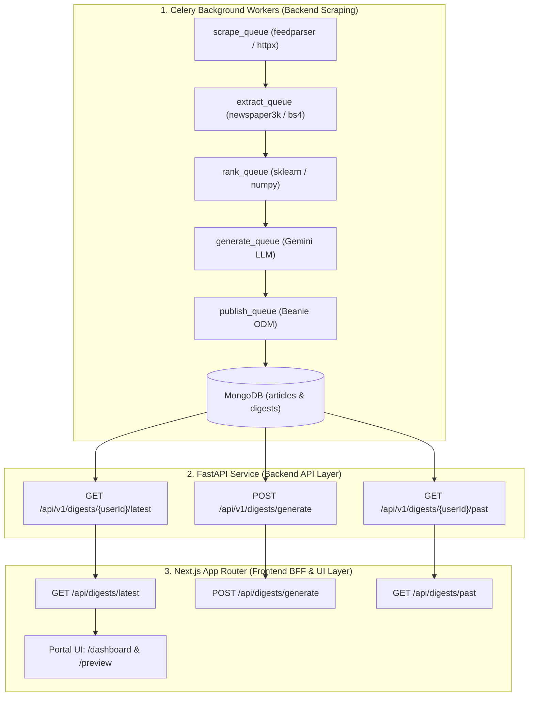
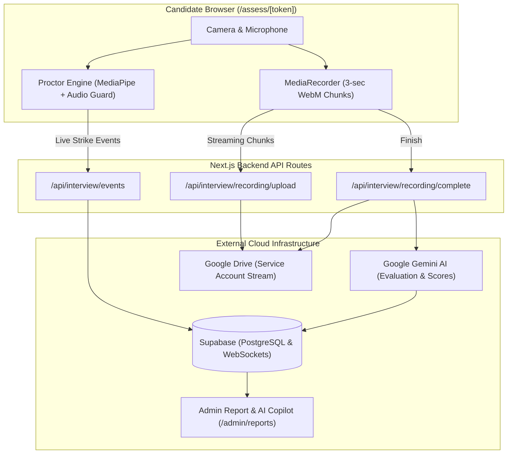
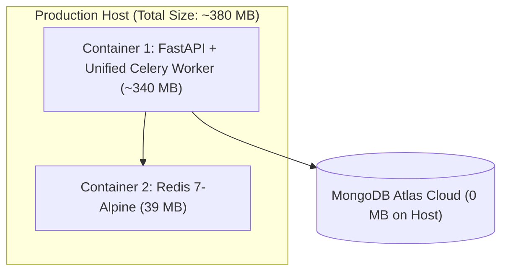

# System Architecture & Technical Flow Guide

This document provides a clean, in-depth architectural breakdown of the **Blog Fetch & Synthesis Module** and the **AI Interview Module**, clearly separating their frontend and backend roles, all URLs, API endpoints, data pipelines, and production deployment sizing.

---

# PART 1: BLOG FETCH & SYNTHESIS MODULE

The **Blog Fetch & Synthesis Module** crawls external engineering blogs (Dev.to, Reddit, HackerNews, RSS), cleans the articles, scores their relevance against Creole's tech stack, synthesizes executive summaries via Gemini AI, and displays personalized daily digests to employees.



---

## 1.1 Backend Role (`fetch-blogs/`)

The Python backend is completely autonomous and handles 100% of the web scraping, data extraction, NLP scoring, and MongoDB storage. **The frontend never scrapes the web directly.**

### Step-by-Step Backend Pipeline:
1. **Queue 1 — `scrape_queue`**:
   - Monitored sites: RSS feeds, TechCrunch, Dev.to, HackerNews, Reddit.
   - Tools: `feedparser`, `httpx`, `tenacity`.
   - Downloads raw HTML payloads in async batches.
2. **Queue 2 — `extract_queue`**:
   - Cleans the raw HTML, strips advertisements, tracking scripts, and navbars.
   - Tools: `newspaper3k`, `beautifulsoup4`, `lxml-html-clean`.
   - Extracts clean Markdown, article text, author, and featured images.
3. **Queue 3 — `rank_queue`**:
   - Calculates relevance against Creole Studios' core technologies (Next.js, Python, AI, Cloud).
   - Tools: `scikit-learn` (TF-IDF & cosine similarity), `textstat` (readability metrics).
   - Drops clickbait or low-quality articles.
4. **Queue 4 — `generate_queue`**:
   - Calls **Google Gemini AI** (`gemini-2.5-flash`).
   - Produces a 3-bullet executive summary, key technical takeaways, and 768-dimensional vector embeddings.
5. **Queue 5 — `publish_queue`**:
   - Saves the final enriched articles into the MongoDB `articles` collection via **Beanie ODM + Motor**.
   - Generates personalized daily digests in the `daily_digests` collection.

---

## 1.2 Frontend Role (`app/` Next.js)

The Next.js frontend acts as the **presentation layer and secure proxy (BFF)**:
* Does **zero** web crawling (preventing browser CORS issues, IP bans, and high CPU usage).
* Queries the Python backend using secure server-side tokens (`X-Internal-Token`).
* Renders the saved digests and articles in `/dashboard` and `/preview`.

---

## 1.3 Complete API & URL Reference for Blog Fetch

### Python FastAPI Backend URLs (`http://localhost:8000/api/v1`):
* `GET /api/v1/digests/{userId}/latest?today_only=true`
  * **Role**: Retrieves today's synthesized tech digest for a user directly from MongoDB.
* `POST /api/v1/digests/generate`
  * **Role**: Forces immediate synthesis of a new digest from available MongoDB articles.
* `GET /api/v1/digests/{userId}/past?date={YYYY-MM-DD}`
  * **Role**: Fetches archived historical digests from MongoDB.
* `POST /api/v1/pipeline/jobs`
  * **Role**: Admin trigger to run an instant crawl job across all 5 Celery queues.
* `GET /api/v1/health`
  * **Role**: Health probe verifying MongoDB connection, Redis heartbeat, and worker status.

### Next.js Internal Proxy APIs (Frontend to Backend):
* `GET /api/digests/latest`
  * Internal Next.js endpoint that securely queries `http://localhost:8000/api/v1/digests/{userId}/latest`.
* `POST /api/digests/generate`
  * Internal route forwarding digest creation requests to FastAPI with the `X-Internal-Token` header.
* `GET /api/digests/by-id?id={id}`
  * Fetches a specific blog by ID (checks PostgreSQL `blogs` table first, then queries FastAPI MongoDB if needed).
* `GET /api/digests/past`
  * Fetches past blog archives for calendar history views.

---
---

# PART 2: AI INTERVIEW MODULE

The **AI Interview Module** is a standalone, browser-to-cloud interview platform built completely inside Next.js, Supabase, and Google Drive. It requires **no Python, MongoDB, or Redis**.



---

## 2.1 Complete Flow of AI Interview

1. **Job Description & Resume Ingestion**:
   - HR uploads JD and Resume $\longrightarrow$ uploaded to Supabase Storage (`ai-interview-documents`).
   - Gemini parses the documents and dynamically creates custom interview questions $\longrightarrow$ saved in Supabase `interview_questions`.
2. **Proctoring Engine**:
   - Candidate opens their unique assessment link (`/assess/[token]` or `/interview/[id]`).
   - Browser client checks:
     - **Face & Device Check**: Tracks face presence and detects unauthorized cellphones via MediaPipe.
     - **Voice Activity Detection**: Flags secondary background voices if sustained past **10 seconds** (`continuousVoiceMs = 10000`).
     - **Fullscreen & Tab Guard**: Logs full-screen exits and tab switches.
   - Violations broadcast in real time to the HR monitor via **Supabase Realtime WebSockets** (`interview-monitor:${sessionId}`).
3. **Zero-Wait Video Streaming to Google Drive**:
   - Video is sliced into 3-second WebM chunks in the candidate's browser.
   - Chunks upload continuously in the background to the Next.js API, which forwards them directly to a Google Drive folder using a **Google Cloud Service Account**.
   - Result: When the candidate clicks "Finish", the video is already 99% uploaded (no waiting screen).
4. **Scoring & Report Generation**:
   - Gemini scores candidate speech transcripts against rubrics, computing cognitive ability, CEFR English fluency, and strengths/weaknesses.
   - Results are stored in Supabase `interview_reports`.
   - HR reviews the scorecard and uses the **Report AI Copilot** chat drawer to query candidate answers.
5. **90-Day Retention Cleanup**:
   - Nightly dispatcher queries recordings older than 90 days and permanently purges the video file from Google Drive, while preserving evaluation reports in Supabase forever.

---

## 2.2 Complete API & URL Reference for AI Interview

* `POST /api/interview/verify`
  * Validates session token, candidate eligibility, and expiration dates.
* `POST /api/interview/recording/upload`
  * Streams 3-second candidate webcam video chunks to Google Drive.
* `POST /api/interview/recording/complete`
  * Closes the Google Drive upload stream and generates the permanent HR playback link (`webViewLink`).
* `POST /api/interview/events`
  * Logs proctoring events (face absent, unauthorized voices, tab changes) to Supabase `interview_events`.
* `POST /api/interview/terminate`
  * Terminates the session immediately if the candidate exceeds allowed proctoring warning strikes.
* `GET /api/interview/reports`
  * Returns candidate scorecards, metrics, and video links for the Admin reports dashboard.
* `POST /api/admin/reports/[id]/chat`
  * Powers the interactive Report AI Copilot drawer for HR.

---
---

# PART 3: PRODUCTION DEPLOYMENT & CONTAINER SIZING

## Do We Really Need All 9 Containers for Blog Fetch?

### 👉 Answer: **NO. You only need 2 to 3 containers.**

The default `docker-compose.prod.yml` defines 9 separate containers:
* `mongo` (MongoDB 7 database)
* `redis` (Redis 7 broker)
* `fastapi-api` (FastAPI web server)
* 5 separate Celery workers: `celery-scrape`, `celery-extract`, `celery-rank`, `celery-generate`, `celery-publish`
* `flower` (Dashboard UI)

**Total size of 9 containers: ~1.7 GB** (Exceeds your 1 GB limit).

---

## Recommended Lean Production Setup (< 1 GB Total Size)



### How to Achieve This:
1. **Run 1 Unified Celery Worker**:
   - Instead of 5 separate containers, run a single worker process that listens to all 5 queues simultaneously:
     ```bash
     celery -A src.workers.celery_app worker -Q scrape_queue,extract_queue,rank_queue,generate_queue,publish_queue -c 2
     ```
   - **Savings**: Removes 4 redundant containers and saves ~400 MB RAM.
2. **Use MongoDB Atlas (Cloud Tier)**:
   - Connect `MONGO_URI` to a free-tier MongoDB Atlas cluster.
   - **Savings**: Removes the heavy 877 MB `mongo:7` local container entirely (**0 MB on your server disk**).
3. **Drop `flower`**:
   - Omit the Flower UI in production.
   - **Savings**: Saves ~100 MB disk space.

### Final Production Footprint:
* **Total Containers**: **2 containers** (FastAPI/Worker + Redis).
* **Disk Space**: **~380 MB** (fits comfortably under the 1 GB budget).
* **RAM Usage**: **~250 MB – 350 MB** total.
