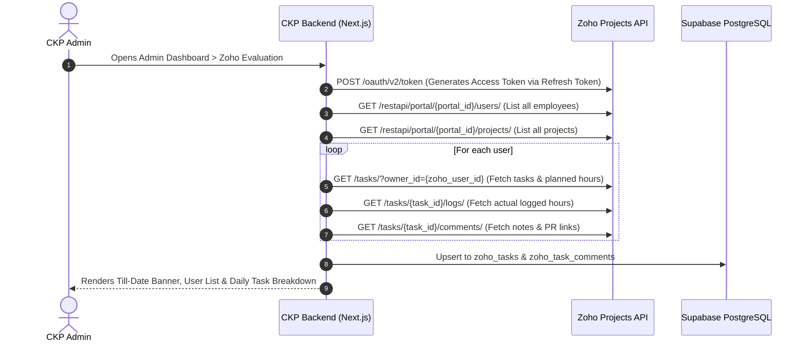

# Setup Guide: Integrating Zoho Admin Account with Creole Knowledge Portal (CKP)

This document provides step-by-step instructions for connecting an **Organization Admin Zoho Account** to CKP so the portal can automatically fetch all employees' tasks, timelogs, comments, and project data across the organization.

---

## 1. Why an Admin Account is Required

In Zoho Projects, individual users can only view projects and tasks assigned to them unless granted elevated permissions. 
By authenticating using a **Zoho Organization Admin / Portal Owner account**, CKP receives organization-wide read access to:
- All active projects across all departments.
- All employees and their internal Zoho user IDs.
- All employee tasks, planned durations, and status updates.
- All employee timesheets (actual logged hours).
- All task comments and technical notes.

---

## 2. Step 1: Register OAuth Application in Zoho API Console

1. Log into [Zoho API Console](https://api-console.zoho.com/) using the **Organization Admin Zoho account**.
2. Click **Add Client**.
3. Select **Server-based Applications** (or **Self Client** for direct daemon token generation).
4. Fill in the client details:
   - **Client Name**: `Creole Knowledge Portal`
   - **Homepage URL**: `https://creoleknowledgeportal.com` (or `http://localhost:3000` for development)
   - **Authorized Redirect URIs**: `http://localhost:3000/api/auth/zoho/callback` and `https://creoleknowledgeportal.com/api/auth/zoho/callback`
5. Click **Create**.
6. Note down the generated:
   - **Client ID**
   - **Client Secret**

---

## 3. Step 2: Required OAuth Scopes

CKP requires read permissions across five Zoho Projects modules:

| Scope | Description | Purpose in CKP |
|---|---|---|
| `ZohoProjects.portals.READ` | Read organization portals | Obtains the organization `portal_id` |
| `ZohoProjects.users.READ` | Read portal users | Maps CKP login emails to Zoho user profiles |
| `ZohoProjects.projects.READ` | Read all projects | Fetches project names and project IDs |
| `ZohoProjects.tasks.READ` | Read all tasks | Fetches task titles, descriptions, planned hours, and status |
| `ZohoProjects.timesheets.READ` | Read timelogs | Fetches actual logged hours for adherence calculation |

Comma-separated scope string:
```text
ZohoProjects.portals.READ,ZohoProjects.users.READ,ZohoProjects.projects.READ,ZohoProjects.tasks.READ,ZohoProjects.timesheets.READ
```

---

## 4. Step 3: Generate Permanent Refresh Token (Self Client Flow)

Since CKP runs automated background syncs without user interaction, a **permanent Refresh Token** is required.

1. In the Zoho API Console, click your registered client and switch to the **Self Client** tab.
2. In the **Scope** input field, paste the scope string:
   ```text
   ZohoProjects.portals.READ,ZohoProjects.users.READ,ZohoProjects.projects.READ,ZohoProjects.tasks.READ,ZohoProjects.timesheets.READ
   ```
3. Set **Time Duration** to `10 minutes` (this only applies to the initial authorization code).
4. In **Scope Description**, enter `CKP Evaluation Sync`.
5. Click **Generate Code** and copy the generated Grant Token (`1000.xxxx...`).
6. Within 10 minutes, open your terminal (PowerShell or Bash) and exchange this code for the permanent `refresh_token`:

```bash
curl -X POST "https://accounts.zoho.com/oauth/v2/token" \
  -d "code={YOUR_GRANT_CODE}" \
  -d "client_id={YOUR_CLIENT_ID}" \
  -d "client_secret={YOUR_CLIENT_SECRET}" \
  -d "grant_type=authorization_code"
```

7. Zoho will return a JSON response:
```json
{
  "access_token": "1000.xxxx...",
  "refresh_token": "1000.yyyy...",
  "api_domain": "https://www.zohoapis.com",
  "token_type": "Bearer",
  "expires_in": 3600
}
```
8. Save the **`refresh_token`**. This token does not expire and will be used by CKP to generate fresh access tokens automatically.

---

## 5. Step 4: Obtain the Zoho Portal ID

1. Using the `access_token` from the previous step, query your organization portal ID:

```bash
curl -X GET "https://projectsapi.zoho.com/restapi/portals/" \
  -H "Authorization: Zoho-oauthtoken {YOUR_ACCESS_TOKEN}"
```

2. Look for `portals[0].id_string` in the response:
```json
{
  "portals": [
    {
      "name": "Creole Studios",
      "id_string": "1892000000000000",
      "is_default": true
    }
  ]
}
```
3. Copy the **`id_string`** (this is your `ZOHO_PORTAL_ID`).

---

## 6. Step 5: Configure Environment Variables in CKP

Add the acquired credentials to your `.env` or `.env.local` file:

```env
# Zoho Projects Organization Integration
ZOHO_CLIENT_ID="1000.xxxxxxxxxxxxxxxxxxxxxxxxxxxxxx"
ZOHO_CLIENT_SECRET="xxxxxxxxxxxxxxxxxxxxxxxxxxxxxxxx"
ZOHO_REFRESH_TOKEN="1000.yyyyyyyyyyyyyyyyyyyyyyyyyyyyyy"
ZOHO_PORTAL_ID="1892000000000000"
```

---

## 7. Step 6: How CKP Fetches All Employees' Data

Once these environment variables are set, the integration operates as follows:



1. **Automated User Mapping**:
   - CKP matches each employee's CKP login email with their Zoho user profile.
2. **Organization-Wide Retrieval**:
   - Because the refresh token belongs to the organization admin, the API calls retrieve tasks and timesheets for **all** employees under that portal without hitting permission blocks.
3. **Database Caching in Supabase**:
   - Data is stored in `zoho_tasks` and `zoho_task_comments` to prevent hitting Zoho's daily API rate limit.
4. **Admin Console Visualization**:
   - In `/admin/dashboard` &rarr; **Zoho Evaluation** tab, admins can filter by week, month, or custom date range to inspect any employee's work logs and scores.

---

## 8. Step 7: Verifying the Connection

You can verify the connection by running:

```bash
# In local development
curl http://localhost:3000/api/admin/zoho/users?type=week&weekOffset=0
```

* If connected properly: Returns `200 OK` with JSON containing mapped login users and their synced Zoho tasks.
* If credentials are unset: Returns realistic sample evaluations with a development notice, ensuring the UI remains operable during onboarding.
