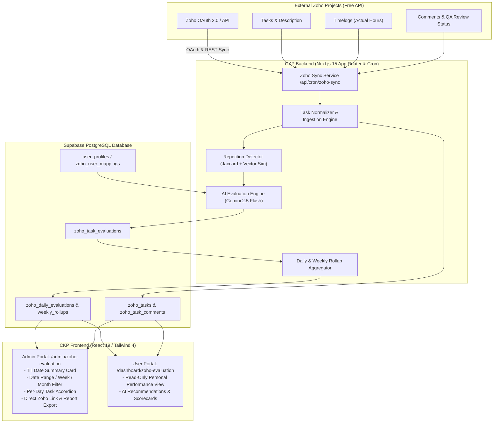

# Technical Design Document: Zoho Projects Integration & AI Task Evaluation Module

## 1. Executive Summary & Architecture Overview

### 1.1 Objective
The **Zoho Projects Integration & Evaluation Module** in the Creole Knowledge Portal (CKP) provides an automated, AI-augmented performance analytics and task evaluation pipeline for every employee. The module pulls task details, timelogs, comments, and status transitions directly from Zoho Projects (utilizing the Zoho Free/Standard API), evaluates each task against custom operational heuristics and Gemini AI models, flags repetitive tasks, computes tolerance-buffered time adherence, and generates actionable task-level and day-level evaluation summaries.

Both Admin and Standard User roles are supported:
- **Admin**: Full oversight, user task per-day inspection, weekly/monthly/custom-range filtering, Till-Date summary cards, Zoho direct deep-linking, and automated report generation.
- **User**: Dedicated Read-Only personal evaluation dashboard displaying task metrics, scores, AI feedback summaries, and historical trends.

### 1.2 System Architecture Diagram



---

## 2. Zoho API Integration (Free Tier) & Synchronization

### 2.1 Zoho Projects API Specifications & Free Tier Constraints
Zoho Projects provides REST APIs secured by OAuth 2.0. On the free tier, API limits include a maximum daily request quota (typically 100-250 calls/day on free organization accounts) and rate limiting (burst limit per minute). To adhere strictly to these constraints:
1. **Delta / Incremental Polling**: Synchronization runs on an incremental cursor (`last_modified_time` or scheduled window) instead of full-table dumps.
2. **Direct Deep Links**: Task links are constructed deterministically without hitting the API to navigate admins/users to the Zoho portal.
3. **Local Cache in Supabase**: All fetched tasks, comments, and timelogs are stored in Supabase to eliminate repetitive Zoho API calls for UI rendering.

### 2.2 OAuth 2.0 Flow & Token Management
- **Zoho Accounts URL**: `https://accounts.zoho.com/oauth/v2/`
- **Zoho API Base URL**: `https://projectsapi.zoho.com/restapi/`
- **Scopes**: `ZohoProjects.projects.READ`, `ZohoProjects.tasks.READ`, `ZohoProjects.timesheets.READ`
- **Token Lifecycle**:
  - `access_token` expires every 60 minutes.
  - Refresh tokens are stored encrypted in the `zoho_integrations` table.
  - An internal helper `getValidZohoAccessToken()` checks expiry; if remaining validity < 5 minutes, it calls `POST https://accounts.zoho.com/oauth/v2/token?refresh_token=...&client_id=...&client_secret=...&grant_type=refresh_token`.

### 2.3 Zoho Endpoints Used
1. **Get Portals**: `GET /restapi/portals/` -> Retrieves `portal_id`.
2. **Get Projects**: `GET /restapi/portal/{portal_id}/projects/`
3. **Get User Tasks**: 
   - `GET /restapi/portal/{portal_id}/projects/{project_id}/tasks/?owner_id={zoho_user_id}&last_modified_time={iso_date}`
4. **Get Task Timelogs**:
   - `GET /restapi/portal/{portal_id}/projects/{project_id}/tasks/{task_id}/logs/`
5. **Get Task Comments**:
   - `GET /restapi/portal/{portal_id}/projects/{project_id}/tasks/{task_id}/comments/`
6. **Task Direct Deep-Link Formula**:
   ```
   https://projects.zoho.com/portal/{portal_id}#taskdetail/{project_id}/{task_id}
   ```

---

## 3. Database Schema & Data Models (Supabase)

```sql
-- 1. Integration Settings & OAuth Storage
CREATE TABLE IF NOT EXISTS public.zoho_integrations (
    id UUID PRIMARY KEY DEFAULT gen_random_uuid(),
    portal_id TEXT NOT NULL,
    portal_name TEXT,
    client_id TEXT NOT NULL,
    client_secret_encrypted TEXT NOT NULL,
    refresh_token_encrypted TEXT NOT NULL,
    access_token TEXT,
    access_token_expires_at TIMESTAMPTZ,
    sync_frequency_minutes INT DEFAULT 30,
    last_synced_at TIMESTAMPTZ,
    created_at TIMESTAMPTZ DEFAULT timezone('utc'::text, now()),
    updated_at TIMESTAMPTZ DEFAULT timezone('utc'::text, now())
);

-- 2. User Mapping Table (CKP User to Zoho User & AI tool metadata)
CREATE TABLE IF NOT EXISTS public.zoho_user_mappings (
    id UUID PRIMARY KEY DEFAULT gen_random_uuid(),
    user_id UUID NOT NULL REFERENCES public.user_profiles(user_id) ON DELETE CASCADE,
    zoho_user_id TEXT NOT NULL UNIQUE,
    zoho_user_email TEXT NOT NULL,
    ai_subscriptions TEXT[] DEFAULT '{"ChatGPT", "GitHub Copilot"}'::text[],
    seniority_level TEXT DEFAULT 'Mid' CHECK (seniority_level IN ('Junior', 'Mid', 'Senior', 'Lead')),
    is_active BOOLEAN DEFAULT true,
    created_at TIMESTAMPTZ DEFAULT timezone('utc'::text, now()),
    updated_at TIMESTAMPTZ DEFAULT timezone('utc'::text, now())
);

-- 3. Zoho Tasks Table
CREATE TABLE IF NOT EXISTS public.zoho_tasks (
    id UUID PRIMARY KEY DEFAULT gen_random_uuid(),
    zoho_task_id TEXT NOT NULL UNIQUE,
    zoho_project_id TEXT NOT NULL,
    project_name TEXT NOT NULL,
    user_id UUID NOT NULL REFERENCES public.user_profiles(user_id) ON DELETE CASCADE,
    task_name TEXT NOT NULL,
    task_description TEXT,
    zoho_status TEXT NOT NULL, -- 'Open', 'In Progress', 'QA Review', 'Closed'
    is_qa_review BOOLEAN DEFAULT false,
    planned_hours NUMERIC(6, 2) NOT NULL DEFAULT 0.00,
    actual_hours NUMERIC(6, 2) NOT NULL DEFAULT 0.00,
    planned_minutes INT GENERATED ALWAYS AS (ROUND(planned_hours * 60)) STORED,
    actual_minutes INT GENERATED ALWAYS AS (ROUND(actual_hours * 60)) STORED,
    task_date DATE NOT NULL,
    zoho_link TEXT NOT NULL,
    created_time TIMESTAMPTZ,
    last_modified_time TIMESTAMPTZ,
    synced_at TIMESTAMPTZ DEFAULT timezone('utc'::text, now())
);

-- 4. Zoho Task Comments
CREATE TABLE IF NOT EXISTS public.zoho_task_comments (
    id UUID PRIMARY KEY DEFAULT gen_random_uuid(),
    zoho_comment_id TEXT NOT NULL UNIQUE,
    zoho_task_id TEXT NOT NULL REFERENCES public.zoho_tasks(zoho_task_id) ON DELETE CASCADE,
    author_name TEXT,
    comment_content TEXT NOT NULL,
    comment_added_time TIMESTAMPTZ,
    created_at TIMESTAMPTZ DEFAULT timezone('utc'::text, now())
);

-- 5. Individual Task Evaluations
CREATE TABLE IF NOT EXISTS public.zoho_task_evaluations (
    id UUID PRIMARY KEY DEFAULT gen_random_uuid(),
    task_id UUID NOT NULL REFERENCES public.zoho_tasks(id) ON DELETE CASCADE,
    user_id UUID NOT NULL REFERENCES public.user_profiles(user_id) ON DELETE CASCADE,
    evaluation_date DATE NOT NULL,
    overall_score INT NOT NULL CHECK (overall_score BETWEEN 0 AND 100),
    
    -- Sub-scores (0 - 100)
    time_score INT NOT NULL,
    comment_quality_score INT NOT NULL,
    complexity_score INT NOT NULL,
    repetition_score INT NOT NULL,
    
    -- Heuristic Details
    time_variance_minutes INT NOT NULL, -- actual - planned in minutes
    time_assessment_label TEXT NOT NULL, -- 'ON_TIME', 'SLIGHT_OVERRUN_TOLERATED', 'UNEXPECTED_EARLY', 'OVERDUE'
    is_repetitive BOOLEAN DEFAULT false,
    repetition_similarity_pct NUMERIC(5, 2) DEFAULT 0.00,
    matched_repetitive_task_id TEXT,
    
    -- AI Generated Feedback
    summary_feedback TEXT NOT NULL,
    strengths TEXT[],
    improvements TEXT[],
    ai_model_used TEXT DEFAULT 'gemini-2.5-flash',
    created_at TIMESTAMPTZ DEFAULT timezone('utc'::text, now())
);

-- 6. User Daily Evaluation Aggregation
CREATE TABLE IF NOT EXISTS public.zoho_daily_evaluations (
    id UUID PRIMARY KEY DEFAULT gen_random_uuid(),
    user_id UUID NOT NULL REFERENCES public.user_profiles(user_id) ON DELETE CASCADE,
    evaluation_date DATE NOT NULL,
    total_tasks INT DEFAULT 0,
    done_tasks INT DEFAULT 0,
    qa_review_tasks INT DEFAULT 0,
    delayed_tasks INT DEFAULT 0,
    total_planned_hours NUMERIC(6, 2) DEFAULT 0.00,
    total_actual_hours NUMERIC(6, 2) DEFAULT 0.00,
    daily_score INT NOT NULL CHECK (daily_score BETWEEN 0 AND 100),
    daily_summary TEXT NOT NULL,
    created_at TIMESTAMPTZ DEFAULT timezone('utc'::text, now()),
    UNIQUE(user_id, evaluation_date)
);

-- 7. Till-Date / Weekly Summary Rollup
CREATE TABLE IF NOT EXISTS public.zoho_user_weekly_rollups (
    id UUID PRIMARY KEY DEFAULT gen_random_uuid(),
    user_id UUID NOT NULL REFERENCES public.user_profiles(user_id) ON DELETE CASCADE,
    week_start_date DATE NOT NULL,
    week_end_date DATE NOT NULL,
    till_date_done_tasks INT DEFAULT 0,
    till_date_not_done_tasks INT DEFAULT 0,
    till_date_delayed_tasks INT DEFAULT 0,
    weekly_avg_score INT DEFAULT 0,
    ai_productivity_index NUMERIC(4, 2) DEFAULT 1.00,
    weekly_remarks TEXT,
    updated_at TIMESTAMPTZ DEFAULT timezone('utc'::text, now()),
    UNIQUE(user_id, week_start_date)
);

-- Indexes for Fast Querying & Filtering
CREATE INDEX IF NOT EXISTS idx_zoho_tasks_user_date ON public.zoho_tasks(user_id, task_date);
CREATE INDEX IF NOT EXISTS idx_zoho_tasks_project ON public.zoho_tasks(zoho_project_id);
CREATE INDEX IF NOT EXISTS idx_zoho_task_eval_date ON public.zoho_task_evaluations(user_id, evaluation_date);
CREATE INDEX IF NOT EXISTS idx_zoho_daily_eval_date ON public.zoho_daily_evaluations(user_id, evaluation_date);

-- Row Level Security (RLS)
ALTER TABLE public.zoho_tasks ENABLE ROW LEVEL SECURITY;
ALTER TABLE public.zoho_task_comments ENABLE ROW LEVEL SECURITY;
ALTER TABLE public.zoho_task_evaluations ENABLE ROW LEVEL SECURITY;
ALTER TABLE public.zoho_daily_evaluations ENABLE ROW LEVEL SECURITY;
ALTER TABLE public.zoho_user_weekly_rollups ENABLE ROW LEVEL SECURITY;

-- Admins: Full Access; Authenticated Users: Read-only for their own data
CREATE POLICY "Admins have full access to zoho_tasks" ON public.zoho_tasks
    FOR ALL TO authenticated
    USING (EXISTS (SELECT 1 FROM public.user_profiles WHERE user_id = auth.uid() AND role = 'admin'));

CREATE POLICY "Users view own zoho_tasks" ON public.zoho_tasks
    FOR SELECT TO authenticated
    USING (user_id = auth.uid());

CREATE POLICY "Admins have full access to zoho_task_evaluations" ON public.zoho_task_evaluations
    FOR ALL TO authenticated
    USING (EXISTS (SELECT 1 FROM public.user_profiles WHERE user_id = auth.uid() AND role = 'admin'));

CREATE POLICY "Users view own zoho_task_evaluations" ON public.zoho_task_evaluations
    FOR SELECT TO authenticated
    USING (user_id = auth.uid());
```

---

## 4. Evaluation Algorithm & Heuristics Formula

The evaluation combines mathematical constraints (time tolerance buffers, repetition distance) with multi-factor Gemini AI synthesis.

### 4.1 Time Tolerance & Gap Analysis

Let $T_{\text{planned}}$ and $T_{\text{actual}}$ be the durations in minutes:
$$\Delta T = T_{\text{actual}} - T_{\text{planned}}$$

#### 1. Overtime Buffer Rule:
- If $\Delta T \le +5\text{ minutes}$, **Zero Penalty**. (e.g. 4 Hours planned, 4 Hours 5 minutes spent is treated as 100% on-time).
- If $\Delta T > +5\text{ minutes}$, Time Score decreases progressively:
  $$\text{Penalty}_{\text{late}} = \min\left(40, \left(\frac{\Delta T - 5}{T_{\text{planned}}}\right) \times 100 \times 0.6\right)$$

#### 2. Early Completion Gap Rule:
- A buffer of **15 minutes early completion** is permitted with zero penalty:
  $$-15 \le \Delta T \le 0 \implies \text{Normal completion (100\% adherence)}$$
- If completed **earlier than 15 minutes** (e.g., 4h planned task completed in 3h 30m, $\Delta T = -30\text{ min}$):
  - Why this affects evaluation: In professional engineering, significant early completion flags:
    1. **Task Over-Estimation / Estimation Inaccuracy** (padding estimates).
    2. **Rushed Implementation / Inadequate Testing** (finishing without thorough local tests or QA).
  - Formula for Early Variance:
    $$\Delta T_{\text{early}} = |\Delta T| - 15 \quad (\text{if } \Delta T < -15)$$
    $$\text{Variance Impact} = \min\left(25, \left(\frac{\Delta T_{\text{early}}}{T_{\text{planned}}}\right) \times 50\right)$$
  - The AI Evaluator inspects comments and QA notes. If test proof/PR link exists and code passed QA cleanly, it classifies this as "High Velocity", awarding an Efficiency Bonus rather than a penalty. If no comments or rushed QA handoff, it registers an "Estimation Mismatch / Risk" penalty.

### 4.2 Repetitive Task Detection Engine
To prevent users from repeatedly logging generic or duplicate tasks (e.g. "Bug fixing", "Minor changes") in the same project:
1. When evaluating Task $T_i$ in Project $P$, we query all tasks by the same user in Project $P$ within the last 30 days ($T_1, T_2, \dots, T_{n}$).
2. Compute **Normalized Jaccard Similarity** and **Levenshtein Word N-Gram Distance**:
   $$\text{Sim}(D_i, D_k) = \frac{|W_i \cap W_k|}{|W_i \cup W_k|}$$
3. If $\text{Sim} > 0.70$ (70% text overlap on title/description in the same project):
   - `is_repetitive = true`
   - Repetition score drops from 100 to $\max(20, 100 - (\text{Sim} \times 100))$
   - The AI evaluation explicitly flags: *"Warning: Similar task logged 3 times in project [Project Name] this month without distinct scope details."*

### 4.3 Multi-Parameter Evaluation Matrix

| Parameter | Source | Weight | Evaluation Criteria |
| :--- | :--- | :---: | :--- |
| **Time Adherence** | Zoho Timelogs vs Planned | 30% | +5 min overtime tolerance; 15 min early completion buffer; strictly 0 hrs with "Not Logged" status if no hours logged. |
| **Task Description & Scope** | Zoho Task Details | 20% | Substantive scope benchmark (40–50 words), technical depth, acceptance criteria vs user seniority; penalizes vague descriptions (e.g. "Continue AI chatbot research"). |
| **Comments & QA Handoff** | Zoho Comments | 20% | Substantive execution notes (40–50 words benchmark) reflecting implementation depth; penalizes checklist comments copying description with status tags ("- Done", "pending"). |
| **Repetitive Task Check** | Project Task History | 15% | Semantic similarity check against recent tasks within the same project. |
| **AI Tool Utilization** | User Subscriptions | 15% | Expected velocity & quality lift based on configured tools (e.g. Copilot, Cursor). |

### 4.4 Description & Comment Substance Rules (Anti-Vagueness & Anti-Checklist)
To ensure engineering accountability and genuine audit trails in Zoho Projects:
1. **Unlogged Timelog Enforcement**:
   - If a developer has not logged actual hours in Zoho Projects, actual spent hours strictly displays **`0 hrs`** with a neutral **`Not Logged`** badge and Time Adherence score of **`0.0 / 10`**.
2. **Vague Description & Checklist Comment Penalization**:
   - If the task description is vague, generic, or brief without detailed requirements (e.g. *"Do Server (Ubuntu) Upgrade. Do php upgrade Update 3 plugins on live Testing on live."*), **Work Justification** score is penalized.
   - If task comments merely copy-paste the description and append status flags (e.g. *"- Done"*, *"pending"*, *"1 is done 2 are pending"*) without explaining the actual code changes, packages upgraded, or QA outcomes, **Work Justification** score is penalized and capped between **`4.0 – 5.0 / 10`**.
3. **Substance Benchmark & Privacy Safeguard**:
   - Both description and comments are expected to meet an engineering benchmark of **40–50 words** to substantiate the task scope.
   - **Privacy Rule**: The explicit "40–50 words" requirement is never displayed in public evaluation cards, summaries, or database records; it is exclusively provided as actionable guidance in the **"Key Areas to Improve & Work On"** coaching section for the user.

---

## 5. Gemini AI Service Implementation (`@google/genai`)

File: `lib/zoho/evaluator.ts`

```typescript
import { GoogleGenAI, Type, Schema } from '@google/genai';

const ai = new GoogleGenAI({ apiKey: process.env.GEMINI_API_KEY });

export interface TaskEvaluationInput {
  taskName: string;
  taskDescription: string;
  projectName: string;
  plannedMinutes: number;
  actualMinutes: number;
  zohoStatus: string;
  isQAReview: boolean;
  comments: string[];
  userExperienceYears: number;
  seniorityLevel: string;
  aiSubscriptions: string[];
  isRepetitive: boolean;
  repetitionSimilarityPct: number;
}

export interface TaskEvaluationResult {
  overallScore: number;
  timeScore: number;
  commentQualityScore: number;
  complexityScore: number;
  repetitionScore: number;
  timeAssessmentLabel: string;
  summaryFeedback: string;
  strengths: string[];
  improvements: string[];
}

const evaluationSchema: Schema = {
  type: Type.OBJECT,
  properties: {
    overallScore: { type: Type.INTEGER, description: 'Composite score 0-100' },
    timeScore: { type: Type.INTEGER, description: 'Time adherence score 0-100' },
    commentQualityScore: { type: Type.INTEGER, description: 'Comment & QA handoff quality 0-100' },
    complexityScore: { type: Type.INTEGER, description: 'Task complexity handled 0-100' },
    repetitionScore: { type: Type.INTEGER, description: 'Score based on originality vs repetition 0-100' },
    timeAssessmentLabel: {
      type: Type.STRING,
      enum: ['ON_TIME', 'SLIGHT_OVERRUN_TOLERATED', 'UNEXPECTED_EARLY', 'OVERDUE']
    },
    summaryFeedback: { type: Type.STRING, description: 'Concise 2-3 sentence performance summary' },
    strengths: { type: Type.ARRAY, items: { type: Type.STRING } },
    improvements: { type: Type.ARRAY, items: { type: Type.STRING } }
  },
  required: [
    'overallScore',
    'timeScore',
    'commentQualityScore',
    'complexityScore',
    'repetitionScore',
    'timeAssessmentLabel',
    'summaryFeedback',
    'strengths',
    'improvements'
  ]
};

export async function evaluateTaskWithGemini(
  input: TaskEvaluationInput
): Promise<TaskEvaluationResult> {
  const prompt = `
You are the Chief Engineering Evaluator for the Creole Knowledge Portal.
Evaluate the following completed software development task based on strict evaluation rules:

RULES:
1. Time Tolerance:
   - Planned: ${input.plannedMinutes} mins. Actual: ${input.actualMinutes} mins.
   - If actual <= planned + 5 mins: No penalty for overtime (allowed buffer).
   - If actual < planned - 15 mins (early completion > 15m gap): Check if task had substantial scope or if it was over-estimated/rushed without QA notes.
2. Repetitive Task Check:
   - Repetition Flag: ${input.isRepetitive} (Similarity: ${input.repetitionSimilarityPct}% in same project).
   - If repetitive, penalize repetitionScore and address it in improvements.
3. User Seniority & AI Tools:
   - Seniority: ${input.seniorityLevel} (${input.userExperienceYears} years exp).
   - Active AI Tools: ${input.aiSubscriptions.join(', ')}.
   - A senior developer with AI tools is expected to provide structured QA notes, concise comments, and realistic estimates.
4. QA Review Status:
   - Status: ${input.zohoStatus} (Moved to QA Review: ${input.isQAReview}).

TASK CONTEXT:
- Project: ${input.projectName}
- Title: ${input.taskName}
- Description: ${input.taskDescription || 'No description provided'}
- Comments Logged:
${input.comments.length > 0 ? input.comments.map((c, i) => `  ${i + 1}. ${c}`).join('\n') : '  None'}

Return your evaluation strictly in the defined JSON schema.
`;

  const response = await ai.models.generateContent({
    model: 'gemini-2.5-flash',
    contents: prompt,
    config: {
      responseMimeType: 'application/json',
      responseSchema: evaluationSchema,
      temperature: 0.2
    }
  });

  return JSON.parse(response.text.trim()) as TaskEvaluationResult;
}
```

---

## 6. Frontend Architecture & UI Components

### 6.1 Component Hierarchy
```
app/admin/dashboard/page.tsx (Admin Dashboard with Zoho Tab)
 ├── ZohoEvaluationManager.tsx (Admin Controller & User Explorer)
 │    ├── ZohoDateFilterPicker.tsx (Week, Month, Range Date Picker with boundaries)
 │    ├── ZohoUserSelectDropdown.tsx (Multi-user checkbox selection for reports)
 │    ├── ZohoTillDateSummary.tsx (Done, In Progress, Delayed, Weekly Score, AI Subscriptions)
 │    ├── Date-Wise Task Breakdown Cards (Project badge, Task name, external link)
 │    ├── ZohoTaskModal.tsx (Hours tolerance, comments thread, 3 square score boxes, dynamic summary)
 │    └── ZohoReportModal.tsx (Employee / Team evaluation reports)

app/dashboard/zoho-evaluation/page.tsx (User Read-Only Portal wrapped in DashboardShell)
 ├── DashboardShell.tsx (User portal layout, sidebar navigation, activity tracking)
 ├── ZohoTillDateSummary.tsx (Personal Read-Only metrics: Done, In Progress, Delayed, Hours, Score)
 ├── ZohoDateFilterPicker.tsx (Period filter with Week, Month, Custom Range - matches admin screen)
 ├── Date-Wise Task Breakdown Cards (Date header, Project badge, clickable task name, read-only)
 └── ZohoTaskModal.tsx (Task evaluation details with hideZohoLink={true} removing Zoho deep-link)
```

### 6.2 Key UI Features
1. **Zoho-Style Filter Bar (`ZohoDateFilterPicker`)**:
   - Presets for Week (Monday-Sunday with ISO week number), Month (12-month calendar grid), and Custom Range.
   - Restricts selection of future periods to ensure integrity of evaluated work.
2. **Till Date Summary Header (Admin & User Screen)**:
   - Displays 4 real-time stat cards:
     - 🟢 **Done Tasks**: Count of tasks closed or marked complete.
     - 🟡 **In Progress**: Current work underway or awaiting QA.
     - 🔴 **Delayed Tasks**: Tasks with actual hours exceeding planned + buffer or past deadline.
     - 🟣 **Rolling Performance Index / Weekly Avg Score**: Composite performance score out of 100 with total logged hours and weekly comparison (+/- %).
3. **Date-Grouped Task Cards**:
   - Grouped cleanly by date (e.g. `2026-10-30`).
   - Project name pill (e.g. `CKP Portal (Creole Knowledge Portal)`).
   - Clickable task title opening the task evaluation modal.
4. **Direct Zoho Task Link (Admin Screen)**:
   - An external icon button rendering `https://projects.zoho.com/portal/{portal_id}#taskdetail/{project_id}/{task_id}` opening in a new tab with `target="_blank" rel="noopener noreferrer"`.
5. **Read-Only Enforced User Experience (User Portal)**:
   - Regular users cannot edit evaluation criteria or trigger administrative bulk reports.
   - In `ZohoTaskModal`, the Zoho direct deep-link ("Open in Zoho") is completely removed for users via `hideZohoLink={true}`.
6. **Task Hours Tolerance with Buffer**:
   - Green: `actual <= planned + 5m` and `actual >= planned - 15m` (Within Buffer).
   - Gray: `actual == 0` (Not Logged — zero hours logged in Zoho Projects).
   - Orange: `actual < planned - 15m` (Early completion gap warning).
   - Red: `actual > planned + 5m` (Buffer exceeded / Overdue).

---

## 7. API Routes Specification

| Method | Endpoint | Access | Purpose |
| :--- | :--- | :--- | :--- |
| `GET`/`POST` | `/api/cron/zoho-evaluation` | Automated Cron (`CRON_SECRET`) | Daily 10:00 PM IST (`30 16 * * *` UTC) crawl: ingests all daily tasks, timelogs & comments, and executes comprehensive AI/heuristic evaluations. |
| `POST` | `/api/admin/zoho/sync` | Admin Session | Triggers on-demand manual mid-day synchronization of tasks, timelogs & comments from Zoho. |
| `POST` | `/api/admin/zoho/evaluate` | Admin / Worker | Runs Gemini AI evaluation on unevaluated tasks and calculates daily rollups. |
| `GET` | `/api/admin/zoho/users` | Admin | Fetches user list with their per-day tasks, evaluation scores, and Zoho deep-links. |
| `GET` | `/api/admin/zoho/summary` | Admin | Fetches the "Till Date Summary" metrics (done, pending, delayed, avg score). |
| `GET` | `/api/admin/zoho/reports/export` | Admin | Generates full evaluation report for filtered date range in JSON/PDF format. |
| `GET` | `/api/user/zoho/my-evaluations` | Authenticated User | Read-only endpoint returning personal tasks, daily summaries, and till-date stats. |

---

## 8. Security, Error Handling & SonarQube Compliance

1. **SonarQube Prevention**:
   - All number validations use `Number.isNaN(val)` and `Number.isFinite(val)` (`typescript:S7773`).
   - String normalization avoids nested greedy regular expressions (`typescript:S8786`).
   - Pure React 19 functional state patterns without synchronous state updates in `useEffect`.
2. **Access Control**:
   - Supabase Row Level Security ensures non-admin users cannot query colleague evaluations or trigger syncs.
3. **Zoho Free Tier Rate Limiting**:
   - Internal token bucket with backoff ensures no more than 30 API calls per minute.
   - Sync service persists `last_synced_at` timestamp per user to fetch only modified records.
