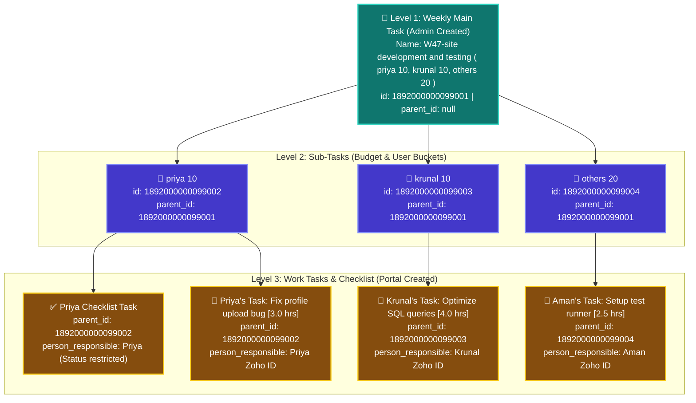

# Zoho Projects Next-Day Task Planning & 3-Tier Hierarchy Workflow Guide

*A complete technical and operational guide for next-day developer task planning, Monday 9:00 AM weekly ingestion, daily 10:00 PM cron synchronization, and Zoho Projects 3-tier task hierarchy.*

---

## 📌 1. Executive Summary

This document specifies the end-to-end architecture and workflow for the **Next-Day Task Planning & Ingestion Engine** within the Creole Knowledge Portal (CKP). It bridges developer task planning on the CKP User Dashboard with **Zoho Projects** and the existing daily evaluation engine through two coordinated cron jobs and a structured 3-tier task hierarchy.

### Core Objectives:
1. **Next-Day Task Planning**: Developers submit their planned tasks for the next working day via the CKP User Dashboard with a strict **10:00 PM cutoff**.
2. **Weekly Monday 9:00 AM Cron**: Identifies the Admin-created Weekly Main Task (`W{WeekNumber}-...`), creates user budget/container subtasks, sets up checklist tasks (assigned strictly to the respective developer), and creates Monday tasks submitted on Friday.
3. **Daily 10:00 PM Cron (Existing + New)**: Evaluates the current day's work, locks next-day task submissions, and automatically dispatches next-day tasks into Zoho Projects under the correct user container.
4. **Accurate User & Project Attribution**: Ensures every task is placed under the correct Level 2 container (`parent_id`) and assigned to the correct user account (`person_responsible`).

---

## 🏗️ 2. End-to-End System Architecture

```mermaid
flowchart TD
    subgraph "CKP User Dashboard (/dashboard)"
        UI["Developer Task Planner Widget<br/>- Project Selector<br/>- Task Title & Description<br/>- Estimated Hours (hr)<br/>- Target Date (Next Working Day)"]
        LOCK["10:00 PM Cutoff Gatekeeper<br/>(Locks inputs at 22:00 IST)"]
        UI --> LOCK
    end

    subgraph "Supabase PostgreSQL Database"
        DB_PLAN["public.zoho_planned_tasks<br/>(Status: draft | queued | synced | failed)"]
        DB_MAP["public.zoho_user_mappings<br/>(CKP user_id <-> zoho_user_id)"]
        DB_CONTAINER["public.zoho_weekly_containers<br/>(Cache for W{Week} Task & Subtask IDs)"]
        LOCK -->|Saves Plan| DB_PLAN
    end

    subgraph "Cron Automation Engine"
        CRON_MON["Monday 9:00 AM Cron<br/>(/api/cron/monday-task-dispatch)<br/>- Fetches Admin W{Week} Task<br/>- Creates User Subtasks & Checklist<br/>- Syncs Friday's Monday Tasks"]
        CRON_DAILY["Daily 10:00 PM Cron<br/>(/api/cron/zoho-evaluation)<br/>- Evaluates Today's Logged Work<br/>- Syncs Next-Day Planned Tasks"]
    end

    subgraph "Zoho Projects REST API"
        ZP_L1["Level 1: Admin Weekly Main Task<br/>'W47-site development ( priya 10, krunal 10, others 20 )'"]
        ZP_L2["Level 2: User Allocation Subtasks<br/>'priya 10', 'krunal 10', 'others 20'"]
        ZP_L3["Level 3: Actual Work Tasks<br/>- 'Fix bug [3.0 hrs]' (parent_id: priya 10)<br/>- 'Checklist Task' (Assigned to Priya)"]
    end

    DB_PLAN --> CRON_MON
    DB_PLAN --> CRON_DAILY
    DB_MAP --> CRON_MON
    DB_MAP --> CRON_DAILY

    CRON_MON -->|1. Searches 'W{Week}'| ZP_L1
    CRON_MON -->|2. Creates Subtasks & Checklist| ZP_L2
    CRON_MON -->|3. Adds Monday Tasks| ZP_L3
    CRON_MON -->|Caches IDs| DB_CONTAINER

    CRON_DAILY -->|Pushes Tue-Fri Tasks| ZP_L3
    DB_CONTAINER -->|Provides parent_id| CRON_DAILY
```

---

## 🌳 3. The 3-Tier Zoho Task Hierarchy

In Creole Studios' active Zoho Projects, tasks follow a structured 3-tier hierarchy representing project milestones, developer hour budgets, and daily work items.



### Hierarchy Breakdown:

| Level | Name / Format | Creator | `parent_id` | Role / Function |
|---|---|---|---|---|
| **Level 1** | `W{WeekNumber}-{Description} ( {user1} {hrs1}, ... )` | Admin (Manual in Zoho) | `null` | Weekly container representing sprint/milestone and budgeted hours. |
| **Level 2** | User bucket (e.g., `priya 10`, `krunal 10`) or `others 20` | Admin / Monday Cron | Level 1 Task ID | Groups developer hours and organizes Level 3 tasks. |
| **Level 3A** | `Checklist - [User Name]` | Monday Cron | Level 2 Subtask ID | Dedicated checklist item. Status updates restricted to assigned developer. |
| **Level 3B** | `[Task Title] - [User Name] - [X.X hr]` | CKP Cron (9 AM Mon / 10 PM Daily) | Level 2 Subtask ID | Actual daily work items with estimated duration and assigned developer. |

---

## 🔑 4. User Entity & Parameter Resolution (How Tasks Link to Correct Users)

To ensure tasks are placed in the right folder and attributed to the right developer, CKP uses **three distinct entities**:

### 1. CKP User Profile & Zoho Mapping (`zoho_user_mappings`)
Every logged-in developer in CKP is linked to their Zoho account:
```
CKP Auth User (juzar@creolestudios.com)
   └── zoho_user_mappings:
         ├── zoho_user_id: "1892000000054321"
         ├── zoho_user_email: "juzar@creolestudios.com"
         └── first_name: "Juzar"
```

### 2. `parent_id` (Folder Placement in Zoho)
The system checks the developer's first name against existing Level 2 subtasks under the Weekly Main Task:
* If the user is **Priya** &rarr; Matches Level 2 subtask `priya 10` &rarr; `parent_id = 1892000000099002`.
* If the user is **Krunal** &rarr; Matches Level 2 subtask `krunal 10` &rarr; `parent_id = 1892000000099003`.
* If the user is **Aman** (no named subtask) &rarr; **Automatic fallback to `others 20`** &rarr; `parent_id = 1892000000099004`.

### 3. `person_responsible` (Task Ownership in Zoho)
Even if Aman's task is nested under `others 20`, the Zoho task creation payload sets:
```json
{
  "name": "Setup automated CI runner [2.5 hrs]",
  "parent_id": "1892000000099004",
  "person_responsible": "aman_zoho_user_id",
  "duration": "02:30",
  "start_date": "11-17-2026"
}
```
**Why this matters**:
* Setting `person_responsible` ensures the task appears on Aman's personal timesheet in Zoho.
* It enables CKP to evaluate Aman's individual performance during the 10:00 PM evaluation cron.
* It keeps the project's overall `others 20` budget organized in Zoho.

---

## ⏰ 5. The Dual Cron Architecture

```mermaid
timeline
    title Weekly Task Planning & Cron Lifecycle
    Friday 22:00 IST : Developers submit Monday tasks on CKP
                     : Friday 10 PM Cron locks Monday submissions
    Monday 09:00 IST : Monday 9 AM Cron triggers
                     : Fetches Admin's W{Week} Main Task
                     : Sets up Level 2 Subtasks & User Checklist
                     : Pushes Friday's Monday Tasks to Zoho
    Mon-Thu 22:00 IST : Daily 10 PM Cron triggers
                      : Evaluates completed day's tasks
                      : Pushes Next-Day planned tasks to Zoho
```

### Cron 1: Monday 9:00 AM Cron (`/api/cron/monday-task-dispatch`)
* **Schedule**: Every Monday at **9:00 AM IST** (`03:30 UTC` &rarr; `30 3 * * 1`).
* **Trigger Responsibility**:
  1. **Calculate Week Number**: e.g., `W47` for ISO week 47.
  2. **Fetch Weekly Main Task**: Calls `GET /portal/{portal_id}/projects/{project_id}/tasks/` and locates the task where the title starts with `W{WeekNumber}` (or `W - {WeekNumber}`).
  3. **Discover or Create Level 2 Subtasks**:
     * Inspects subtasks under the Weekly Main Task (`priya 10`, `krunal 10`, `others 20`).
     * If user-specific subtasks or the `others` subtask do not exist, creates them.
  4. **Create Level 3A Checklist Task**:
     * Creates a checklist subtask under each user's Level 2 bucket.
     * Sets `person_responsible = zoho_user_id` so only the assignee can update its progress.
  5. **Sync Friday's Monday Tasks**:
     * Queries `zoho_planned_tasks` for tasks with `target_date = Current Monday` and `status = 'queued'`.
     * Creates each task under the developer's matching Level 2 subtask in Zoho.
     * Updates database record status to `'synced'` with the generated `zoho_task_id`.
  6. **Cache Containers**: Stores the Weekly Parent ID and User Subtask IDs in `zoho_weekly_containers` for reuse throughout the week.

### Cron 2: Daily 10:00 PM Cron (`/api/cron/zoho-evaluation`)
* **Schedule**: Monday to Friday at **10:00 PM IST** (`16:30 UTC` &rarr; `30 16 * * 1-5`).
* **Execution Flow**:
  1. **Phase 1 — Daily Evaluation (Existing Engine)**:
     * Pulls today's completed tasks, timelogs, comments, and QA review statuses from Zoho.
     * Runs heuristic and Gemini AI evaluations.
     * Dispatches daily evaluation emails and digest to users and seniors.
  2. **Phase 2 — Next-Day Task Creation (New Ingestion Engine)**:
     * **Monday, Tuesday, Wednesday, Thursday Nights**:
       * Selects all planned tasks submitted before 10:00 PM where `target_date = Next Day`.
       * Looks up the user's cached Level 2 subtask ID from `zoho_weekly_containers`.
       * Calls Zoho API `POST /tasks/` to create Level 3 tasks.
       * Marks records as `'synced'`.
     * **Friday Night**:
       * Evaluates Friday's work.
       * Locks Monday's planned tasks in `zoho_planned_tasks` with status `'queued'`.
       * Leaves them queued for the **Monday 9:00 AM Cron** (waiting for the Admin to create next week's `W{NextWeek}` task in Zoho).

---

## 💻 6. Database Schema (Supabase)

To support next-day task planning, queuing, and hierarchical caching, the following tables are integrated:

```sql
-- 1. Table: zoho_planned_tasks
-- Stores developer-submitted next-day tasks before they are pushed to Zoho
CREATE TABLE IF NOT EXISTS public.zoho_planned_tasks (
    id UUID PRIMARY KEY DEFAULT gen_random_uuid(),
    user_id UUID NOT NULL REFERENCES public.user_profiles(user_id) ON DELETE CASCADE,
    zoho_project_id TEXT NOT NULL,
    project_name TEXT NOT NULL,
    target_date DATE NOT NULL,
    task_name TEXT NOT NULL,
    task_description TEXT,
    planned_hours NUMERIC(4, 2) NOT NULL DEFAULT 1.00,
    status TEXT NOT NULL DEFAULT 'queued' CHECK (status IN ('draft', 'queued', 'synced', 'failed')),
    zoho_task_id TEXT,
    zoho_parent_subtask_id TEXT,
    sync_error TEXT,
    created_at TIMESTAMPTZ DEFAULT timezone('utc'::text, now()),
    synced_at TIMESTAMPTZ
);

CREATE INDEX IF NOT EXISTS idx_zoho_planned_tasks_target 
ON public.zoho_planned_tasks(target_date, status);

-- 2. Table: zoho_weekly_containers
-- Caches the weekly Level 1 Main Task ID and Level 2 User Subtask IDs per project
CREATE TABLE IF NOT EXISTS public.zoho_weekly_containers (
    id UUID PRIMARY KEY DEFAULT gen_random_uuid(),
    week_number INT NOT NULL,
    year INT NOT NULL,
    zoho_project_id TEXT NOT NULL,
    admin_parent_task_id TEXT NOT NULL,
    admin_parent_task_name TEXT NOT NULL,
    user_subtask_mappings JSONB NOT NULL DEFAULT '{}'::jsonb, 
    -- e.g. { "priya": { "subtask_id": "1892000000099002", "checklist_id": "..." }, "others": { ... } }
    created_at TIMESTAMPTZ DEFAULT timezone('utc'::text, now()),
    updated_at TIMESTAMPTZ DEFAULT timezone('utc'::text, now()),
    UNIQUE(week_number, year, zoho_project_id)
);
```

---

## 🖥️ 7. CKP User Dashboard Interface (UI/UX)

### User Flow on `/dashboard/zoho-evaluation`:
1. **Next-Day Planner Card**:
   * Shows a clean card titled **"Plan Tomorrow's Tasks"** (or **"Plan Monday's Tasks"** on Fridays).
   * Displays the countdown to the **10:00 PM cutoff**.
2. **Form Inputs**:
   * **Project**: Dropdown populated from active Zoho projects.
   * **Task Title**: Clear title input (e.g., `Refactor user authentication flow`).
   * **Estimated Hours**: Numeric input / slider (e.g., `4.0 hrs`).
   * **Description / Acceptance Criteria**: Textarea for detailed technical expectations.
3. **Cutoff Behavior**:
   * Before 10:00 PM: Users can add, edit, or delete items.
   * At 10:00 PM: Form locks automatically; shows badge: `"Locked & Queued for Zoho Sync at 10:00 PM"`.

---

## ⚙️ 8. Matching Algorithm & Code Logic

Here is the exact algorithmic logic used by the backend service to match users to their subtask bucket:

```typescript
export interface SubtaskBucket {
  id_string: string;
  name: string;
}

/**
 * Resolves the correct parent_id for a developer under the Weekly Main Task
 */
export function resolveTargetSubtaskId(
  userFirstName: string,
  subtasks: SubtaskBucket[]
): string {
  const cleanUser = userFirstName.trim().toLowerCase();

  // 1. Direct user match: subtask starts with user's first name (e.g., "priya 10")
  const namedSubtask = subtasks.find(sub => {
    const cleanName = sub.name.trim().toLowerCase();
    return cleanName.startsWith(cleanUser + ' ') || cleanName === cleanUser;
  });

  if (namedSubtask) {
    return namedSubtask.id_string;
  }

  // 2. Fallback match: "others" bucket (e.g., "others 20")
  const othersSubtask = subtasks.find(sub =>
    sub.name.trim().toLowerCase().startsWith('others')
  );

  if (othersSubtask) {
    return othersSubtask.id_string;
  }

  // 3. Fallback to first available subtask if neither exists
  if (subtasks.length > 0) {
    return subtasks[0].id_string;
  }

  throw new Error(`No subtask or 'others' bucket found for user: ${userFirstName}`);
}
```

---

## 🛡️ 9. Edge Cases & Safeguards

| Scenario | Risk | System Safeguard |
|---|---|---|
| **Admin has not created `W{Week}` task by Monday 9:00 AM** | Cron cannot find parent task | Cron sends an alert notification/email to the project manager and schedules an automatic retry every 30 minutes up to 11:30 AM. |
| **Developer submits tasks for multiple projects** | Tasks routed to wrong project | The planner form requires explicit project selection per task item; the cron groups tasks by `zoho_project_id` and queries the corresponding project container. |
| **Developer name not listed in Level 2** | Task orphaned without bucket | Automatic fallback logic routes the task under the `others [hrs]` subtask while keeping `person_responsible` assigned to that specific developer. |
| **Checklist status changed by non-assignee** | Unauthorized status progression | Level 3A checklist tasks are explicitly assigned to the developer's Zoho User ID, preventing unauthorized updates in Zoho Projects. |
| **User tries to submit after 10:00 PM** | Inconsistent cron dispatch | Frontend UI disables submission, and backend API enforces server-side time validation against 10:00 PM IST. |

---

## 📋 10. Summary Table of Operations

| Operation | Time / Frequency | Actor / Service | Outcome |
|---|---|---|---|
| **Create Weekly Main Task** | Before Monday 9:00 AM | Admin (Zoho UI) | Task named `W{Week}-...` created in Zoho. |
| **Add Next-Day Tasks** | Daily until 10:00 PM | Developer (CKP UI) | Tasks stored as `'queued'` in Supabase. |
| **Weekly Ingestion & Setup** | Monday 09:00 AM IST | Monday Cron | Locates `W{Week}`, creates user subtasks + checklists, syncs Friday's Monday tasks. |
| **Daily Ingestion & Evaluation** | Mon-Thu 10:00 PM IST | Daily 10 PM Cron | Evaluates completed work, creates next-day tasks in Zoho. |
| **Weekend Queuing** | Friday 10:00 PM IST | Daily 10 PM Cron | Evaluates Friday's work, holds Monday's planned tasks for Monday 9:00 AM cron. |

