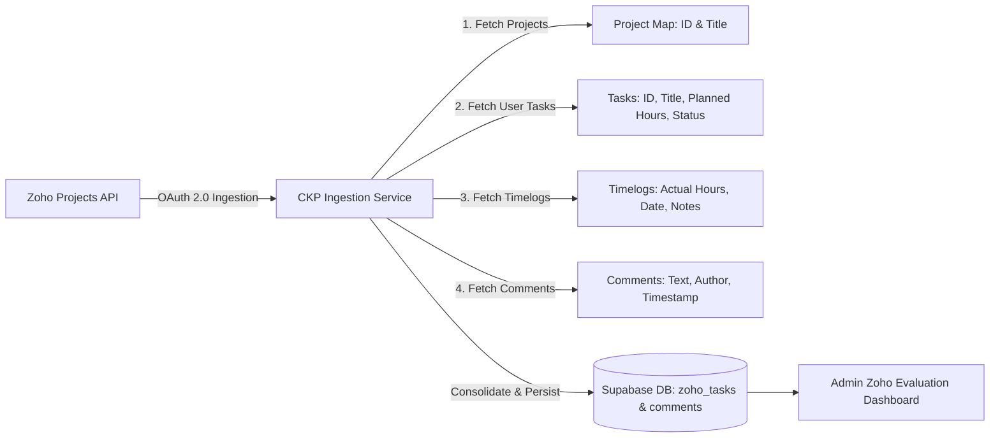

# Technical Guide: Fetching Tasks, Projects, Hours & Comments from Zoho Projects

This guide details the complete data extraction and ingestion pipeline for pulling **Task Titles**, **Project Titles**, **Planned & Actual Hours**, and **Comments** from Zoho Projects into the Creole Knowledge Portal (CKP).

---

## 1. High-Level Data Flow



---

## 2. Step-by-Step Data Extraction Process

### Step 1: Automated OAuth 2.0 Token Refresh
Before making API calls, the backend checks the validity of the cached `access_token`. If expired or near expiration (< 5 minutes), it fetches a new token:

* **Endpoint**: `POST https://accounts.zoho.com/oauth/v2/token`
* **Payload**:
  ```http
  refresh_token={ZOHO_REFRESH_TOKEN}
  &client_id={ZOHO_CLIENT_ID}
  &client_secret={ZOHO_CLIENT_SECRET}
  &grant_type=refresh_token
  ```
* **Authorization Header**: Used in all subsequent requests:
  ```http
  Authorization: Zoho-oauthtoken {access_token}
  ```

---

### Step 2: Fetch Project Titles & IDs
To associate tasks with readable project names, query all active projects in the organization.

* **Endpoint**: `GET https://projectsapi.zoho.com/restapi/portal/{portal_id}/projects/?status=active`
* **Response Mapping**:
  ```json
  {
    "projects": [
      {
        "id_string": "1892000000045001",
        "name": "CKP Knowledge Portal",
        "status": "active"
      }
    ]
  }
  ```
* **Extracted Fields**:
  - `id_string` &rarr; `zoho_project_id`
  - `name` &rarr; `project_name` (Project Title)

---

### Step 3: Fetch Tasks (Task Title & Planned Hours)
Query tasks assigned to a specific employee for the selected project and date.

* **Endpoint**: `GET https://projectsapi.zoho.com/restapi/portal/{portal_id}/projects/{project_id}/tasks/?owner_id={zoho_user_id}&last_modified_time={YYYY-MM-DD}`
* **Response Mapping**:
  ```json
  {
    "tasks": [
      {
        "id_string": "1892000000098023",
        "name": "Implement Supabase RLS and DB Migration",
        "description": "Create migration scripts for zoho_tasks table with security policies.",
        "duration": "4:00",
        "duration_in_hours": 4.0,
        "status": {
          "name": "QA Review",
          "type": "closed"
        }
      }
    ]
  }
  ```
* **Extracted Fields**:
  - `id_string` &rarr; `zoho_task_id`
  - `name` &rarr; `task_name` (Task Title)
  - `description` &rarr; `task_description`
  - `duration_in_hours` or parsed `duration` ("4:00") &rarr; `planned_hours` (e.g., `4.0`)
  - `status.name` &rarr; `zoho_status`
  - `is_qa_review` &rarr; `true` if status matches "QA Review"

---

### Step 4: Fetch Timelogs (Actual Logged Hours)
Planned hours are only estimates. The actual time spent by the employee is extracted from the task timesheet log.

* **Endpoint**: `GET https://projectsapi.zoho.com/restapi/portal/{portal_id}/projects/{project_id}/tasks/{task_id}/logs/`
* **Response Mapping**:
  ```json
  {
    "timelogs": {
      "tasklogs": [
        {
          "id": "1892000000105002",
          "hours": 4,
          "minutes": 5,
          "log_date": "2026-10-29",
          "notes": "Completed migration and verified Supabase policies locally."
        }
      ]
    }
  }
  ```
* **Calculation**:
  $$\text{actual\_hours} = \sum \left( \text{hours} + \frac{\text{minutes}}{60} \right)$$
* **Buffer & Tolerance Evaluation**:
  - **5-Minute Overrun Grace**: If planned is `4.0h` and actual is `4h 5m` (4.08h), score is not penalized.
  - **15-Minute Early Buffer**: If finished significantly early without justification, flag for review.

---

### Step 5: Fetch Task Comments & Updates
Retrieves developer comments, blocker updates, and Pull Request (PR) links.

* **Endpoint**: `GET https://projectsapi.zoho.com/restapi/portal/{portal_id}/projects/{project_id}/tasks/{task_id}/comments/`
* **Response Mapping**:
  ```json
  {
    "comments": [
      {
        "id": "1892000000112001",
        "content": "PR #42 opened: https://github.com/... Ready for QA review.",
        "added_by": "Srushti Amin",
        "added_time": "2026-10-29T16:30:00Z"
      }
    ]
  }
  ```
* **Extracted Fields**:
  - `content` &rarr; Comment body text
  - `added_by` &rarr; Author name
  - `added_time` &rarr; Timestamp

---

### Step 6: Direct Zoho Deep-Link Generation
Enables one-click navigation from CKP directly to that task in Zoho Projects:

```ts
export function buildZohoTaskDeepLink(portalId: string, projectId: string, taskId: string): string {
  return `https://projects.zoho.com/portal/${portalId}#taskdetail/${projectId}/${taskId}`;
}
```

---

### Step 7: Database Persistence & Admin UI Delivery

1. **Upsert into `zoho_tasks`**:
   - Stores `zoho_task_id`, `project_name`, `task_name`, `planned_hours`, `actual_hours`, `zoho_status`, `is_qa_review`, `zoho_link`, and `task_date`.
2. **Insert into `zoho_task_comments`**:
   - Stores task comments with author and timestamps.
3. **Admin Dashboard UI View**:
   - Mounted in `/admin/dashboard` &rarr; **Zoho Evaluation** tab.
   - Shows user list, date filter, task cards, planned vs. actual hours pill, and task detail drawer.
