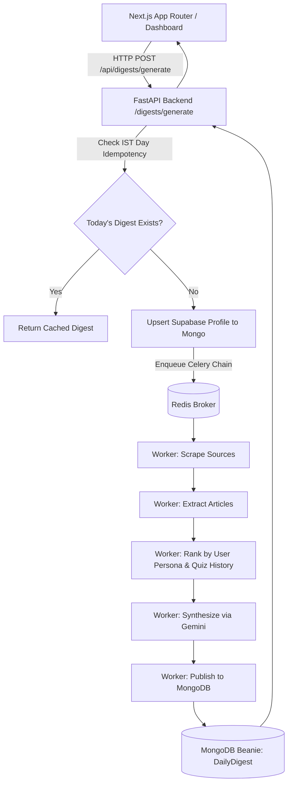
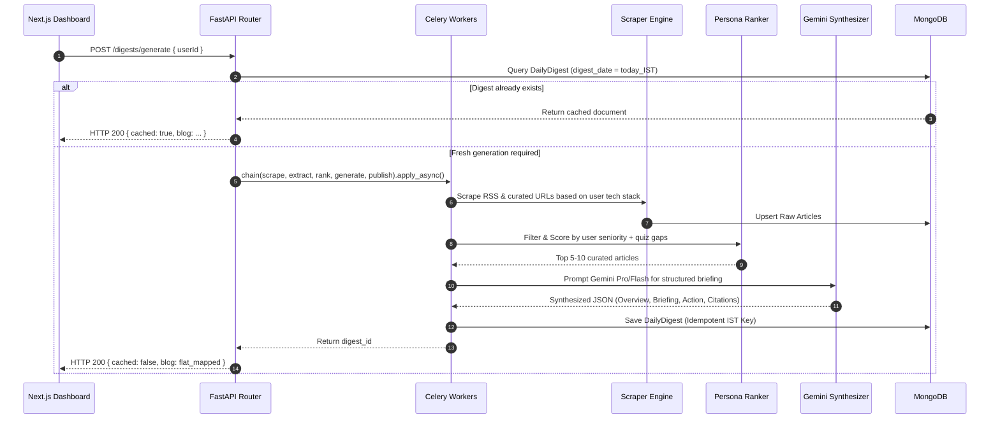

# Complete Architectural & Operational Flow: Blog Fetch & AI Interview Modules

## Executive Summary
This document provides the definitive, comprehensive architectural specification and end-to-end execution flow for both core modules of the **Creole Knowledge Portal**:
1. **Blog Fetch & Synthesis Module** (Python FastAPI + Celery + MongoDB + Gemini)
2. **AI Interview Module** (Next.js 15 + Supabase + Google Drive + MediaPipe / TensorFlow.js)

It serves as the technical blueprint and reference model for all subsequent codebase integrations, ensuring zero regression and strict adherence to architectural contracts when merging `feature/ai-interview-up` into `main`.

---

# Part 1: Blog Fetch Module Flow

## 1.1 Architecture & Component Topology
The Blog Fetch system delivers automated, hyper-personalized daily technical briefings to engineers and trainees. It operates as an asynchronous, distributed pipeline decoupled from the Next.js frontend.



### Key Components:
- **FastAPI API Layer (`fetch-blogs/src/api/routes/`)**: Exposes endpoints for digest retrieval (`GET /digests/{user_id}/latest`), on-demand generation (`POST /digests/generate`), historical archives (`GET /digests/{user_id}/past`), and pipeline triggers.
- **Celery Distributed Task Chain (`fetch-blogs/src/workers/`)**: Orchestrates the 5-stage pipeline with Redis backing.
- **MongoDB Database (`Beanie ODM`)**: Stores scraped raw sources, extracted articles, user profiles, pipeline execution jobs, and finalized `DailyDigest` documents.
- **Supabase Integration**: Synchronizes user tech stack, interests, role seniority, and quiz performance into MongoDB profiles on every generation trigger.

---

## 1.2 The 5-Stage Synthesis Pipeline



### Stage Breakdown:
1. **Scraping (`scraper_tasks.py`)**: Fetches engineering blogs, official releases, RSS feeds, and technical docs tailored to the user's primary languages (e.g., Python, React, Next.js, Node.js).
2. **Extraction (`extractor_tasks.py`)**: Cleans raw HTML, strips boilerplate, removes ads/lifestyle content (`is_off_topic_lifestyle`), and normalizes markdown.
3. **Ranking (`ranker_tasks.py`)**:
   - Calculates relevance scores using user profile keywords and recent quiz weak spots.
   - Weights articles: Trainees receive foundational best practices; Seniors receive architectural patterns and performance deep-dives.
4. **Synthesis (`generator_tasks.py` & `synthesizer.py`)**:
   - Invokes Google Gemini with structured output schemas.
   - Enforces the 4-part structure: **Daily Overview**, **Briefing** (with code snippets and diagrams), **Key Action** (actionable takeaways), and **Source and Citation**.
   - Detects and handles Gemini API quota limits (`HTTP 429`) gracefully, surfacing clear retry guidelines.
5. **Publishing (`publisher_tasks.py`)**:
   - Persists into MongoDB `DailyDigest` with unique `(user_id, digest_date)` index.
   - Formats content for the Next.js Dashboard via `flat_map_digest_for_dashboard`.

---

# Part 2: AI Interview Module Flow

## 2.1 Architecture & End-to-End Candidate Journey
The AI Interview Module manages candidate assessments from link generation to live proctored examination and multi-tier evaluation.

```mermaid
graph TD
    subgraph 1. Admin Creation
        ADM[Admin Dashboard] -->|Upload Resume & JD| CRT[POST /api/admin/ai-interviews]
        CRT --> G_EXT[Gemini Document Extraction & Validation]
        G_EXT --> G_QG[Gemini Adaptive Question Generation]
        G_QG --> DB_STORE[Supabase DB: ai_interviews / interview_invites]
        DB_STORE --> INV_LINK[Unique Token Link + Passcode]
    end

    subgraph 2. Candidate Access & Lobby
        CAN[Candidate Browser] -->|Open Token Link| LOBBY[/assess/:token]
        LOBBY --> VFY[POST /api/interview/verify]
        VFY --> LOCK{Acquire Join Lock & Concurrency Check}
        LOCK -->|Single Device Verified| CALIB[Hardware Check: Camera, Mic, Screen Share]
        CALIB --> ACK[Candidate Instructions Acknowledgment]
    end

    subgraph 3. Live Interview & Proctoring Engine
        ACK --> START[POST /api/interview/start]
        START --> LIVE[Active Question Loop]
        LIVE --> VREC[Canvas Compositor: Camera PiP + Screen 720p 15fps]
        LIVE --> PROC[Proctoring Watchdog: Face, Voice, Object]
        PROC -->|Tab Switch or Refresh| TERM[Immediate Termination & Lockout]
        PROC -->|Violation Warnings| STRIKE[Serial Strikes 1-3]
        STRIKE -->|Strike 3| TERM
        VREC --> STREAM[Resumable 256KiB Chunk Streaming to Google Drive]
    end

    subgraph 4. Report & Retention
        TERM --> EVAL[Evaluation Engine: Gemini Pro/Flash]
        LIVE -->|Completed| EVAL
        EVAL --> REP[Candidate Evaluation Report Card]
        REP --> FILLER[Verbatim Hesitation & Filler Word Analysis]
        REP --> ZOHO[Zoho Recruit Integration]
        REP --> RET[90-Day Retention Purge Dispatcher]
    end
```

---

## 2.2 Detailed Operational Stages

### Stage 1: Document Upload & AI Question Generation
- **Inputs**: Candidate Resume (PDF/DOCX) + Job Description (File upload or direct text paste).
- **AI Validation**: Gemini validates input document types, blocking cross-uploads (e.g., resume uploaded as JD).
- **Question Generation**: Gemini dynamically analyzes resume experience vs. JD requirements to produce:
  - Technical deep-dive questions
  - Architectural scenario questions
  - Behavioral questions
- **Security**: Generates cryptographic invite tokens and bcrypt-salted passcodes.

### Stage 2: Passcode Verification & State-Aware Concurrency Lock
- **Endpoint**: `POST /api/interview/verify`
- **Concurrency Locking (`session-lock.ts`)**:
  - Uses an atomic in-memory lock to guarantee only one candidate device can access an interview simultaneously.
  - Rejects concurrent device access with `HTTP 409 CONCURRENT_SESSION_DETECTED`.
- **Lobby Refresh Safety**:
  - Distinguishes between setup (`pending`) and live interview (`in_progress`).
  - Candidates can safely refresh their browser during lobby calibration without triggering termination.
  - Verification does not prematurely set `status = 'in_progress'` until the candidate actively clicks "Begin Interview".

### Stage 3: Unified Proctoring Engine
The proctoring system operates client-side via WebWorkers and Web APIs:
1. **Face Guard (MediaPipe FaceMesh)**:
   - Tracks face presence, eye gaze direction, and orientation.
   - Detects missing face or candidate looking away from screen for prolonged intervals.
2. **Object Guard (TensorFlow.js COCO-SSD)**:
   - Scans camera stream for prohibited items (mobile phones, tablets, second persons, external books).
3. **Voice Guard (Web Audio API `AudioContext`)**:
   - Analyzes frequency spectra and background speech patterns to detect secondary voices whispering answers.
4. **Environment Watchdog**:
   - Detects browser focus loss, tab switching (`visibilitychange`), window minimization, or page reload during active state.
   - Triggers **immediate session termination** with explicit reason badges.

### Stage 4: Resilient Google Drive Video Recording
To avoid serverless payload limits (4.5MB Vercel limit) and client-side OOM crashes:
- **Canvas Compositing**:
  - Off-screen `<canvas>` compositing captures Screen Share (background) + WebCam (bottom-right Picture-in-Picture) at 720p @ 15 FPS.
  - Audio track is mixed and appended directly.
- **Live Chunk Streaming (`/api/interview/recording/stream-chunk`)**:
  - Browser buffers recording in 256 KiB slices.
  - Continuously streams slices to Google Drive via resumable upload session URLs.
  - Finalization takes **< 1 second** upon interview completion or termination because 99% of the video is already uploaded.
- **Fail-Safe IndexedDB Mirroring**:
  - Video chunks are mirrored in local IndexedDB (`recording-storage.ts`).
  - If a network drop interrupts streaming, `flushAndUploadCachedRecording` recovers and transmits the video seamlessly.

### Stage 5: Evaluation, Filler Word Analysis & 90-Day Retention
- **Gemini Evaluation**: Scores responses across technical competence, problem-solving, and communication clarity.
- **Filler Word Detection**: Analyzes transcripts verbatim for verbal hesitations (`um`, `uh`, `like`, `you know`), highlighting them in a stylized amber badge and computing speech fluency metrics.
- **90-Day Retention Dispatcher (`/api/cron/cleanup-recordings`)**: Automatically purges recordings older than 90 days from Google Drive while preserving evaluations and transcripts indefinitely.

---

# Part 3: Branch Comparison & Merge Conflict Audit

## 3.1 Git Ancestry & Conflict Verification
A rigorous git tree analysis was conducted comparing `feature/ai-interview-up` (`HEAD`) against `main` and `creole/main`:

| Metric | Status | Finding |
| :--- | :--- | :--- |
| **Ancestor Check** (`git merge-base`) | ✅ Clean Ancestor | `creole/main` is an exact ancestor of `feature/ai-interview-up`. |
| **Commits Ahead** | 87 Commits | All feature work builds cleanly on top of `main`. |
| **Commits Behind** | 0 Commits | `main` has no divergent commits not present in `feature/ai-interview-up`. |
| **Merge Simulation** (`git merge-tree`) | ✅ ZERO Conflicts | Output: `NO CONFLICTS DETECTED`. Clean fast-forward / 3-way merge. |

## 3.2 Key Changes Incorporated in `feature/ai-interview-up`
1. **Full Resumable Google Drive Video Streaming**: Added `/api/interview/recording/stream-chunk`, `use-full-interview-recorder.ts`, and fallback upload routes.
2. **Proctoring Refresh & Concurrency Hardening**: Refactored `session-lock.ts` and `app/api/interview/verify/route.ts` to allow safe lobby refresh while strictly terminating active session breaches.
3. **90-Day Retention Engine**: Automated cron dispatcher for cloud storage compliance.
4. **Verbatim Filler Word Analyzer**: Component integration in candidate evaluation reports.
5. **Proctoring Warning & On-Screen Banner Synchronization**: Precision timestamped navigation deep-linked to video playback seconds.
