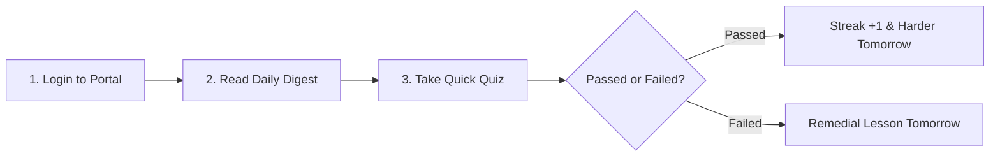
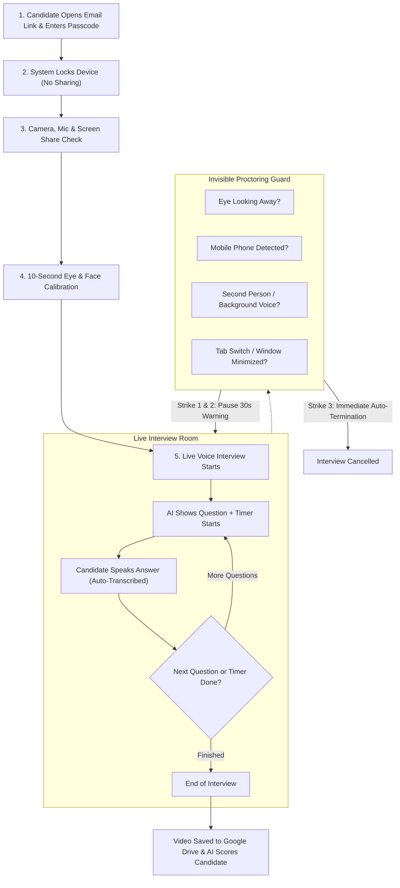
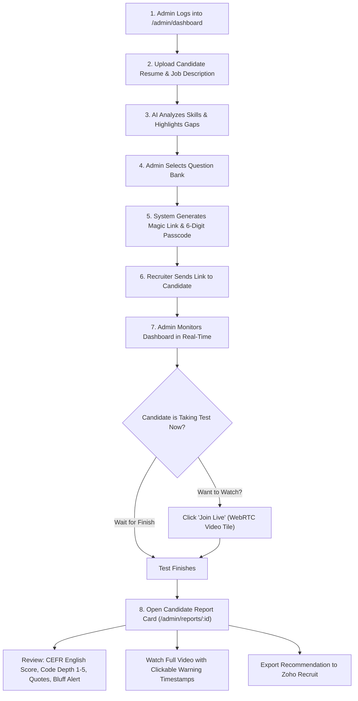

# Creole Knowledge Portal — User & Admin Journey Guide (Simplified & Complete)

> 💡 **Who is this guide for?**  
> This guide is written in **plain, simple language** for anyone new to the project — whether you are a new developer, product manager, QA tester, HR recruiter, or teammate. Even if you have never seen a single line of code in this project, this document will walk you through **every step of how the system works** from both the **User's** and the **Admin's** perspective.

---

## 🌟 1. The Big Picture: What is Creole Knowledge Portal?

The **Creole Knowledge Portal** is an all-in-one web platform with **two main purposes**:

```
                       Creole Knowledge Portal
                                  │
         ┌────────────────────────┴────────────────────────┐
         ▼                                                 ▼
   1. LEARNING & BLOGS                              2. AI INTERVIEWS
   Delivers a personalized daily                    Conducts fully automated,
   tech article to engineers every                  cheating-protected voice
   morning, followed by a quick                     interviews with job candidates,
   quiz to track their daily progress.              and scores them instantly.
```

### Who Uses the System?

1. **Regular User (Learner / Engineer)**:
   - Reads a personalized daily tech blog.
   - Takes a 3-question quiz to test understanding.
   - Builds a daily reading streak and competes on a team leaderboard.
   - Can write and share their own tech articles with teammates.
2. **Job Candidate (Interviewee)**:
   - Receives an email link and passcode from a recruiter.
   - Opens the link in a browser, allows camera/mic/screen share.
   - Takes an automated voice interview where the AI asks questions, listens to answers, and ensures no cheating occurs.
3. **Admin (Recruiter / Tech Lead / Manager)**:
   - Creates new interview links by simply uploading a candidate's Resume and Job Description.
   - AI automatically recommends interview questions based on what the candidate knows and what they lack.
   - Generates the test link and passcode to send to the candidate.
   - Can watch candidate tests live or join in like a video call.
   - Reviews a comprehensive AI evaluation report (scores, spoken answers, English fluency rating, video recording, and hire/no-hire advice).
   - Manages blog feeds and approves community articles.

---

## 📖 2. The User Journey: Daily Blog & Upskilling

> **Goal**: Help software developers learn something new every single day in just 15–20 minutes without having to search the internet for articles.

### Visual Flow of the User's Daily Routine



---

### Step-by-Step Walkthrough

#### Step 1: User Logs In
* **What the user does**: Visits the website and logs in with their company email.
* **What they see**: Lands directly on their **Dashboard** (`/dashboard`).

#### Step 2: Getting Today's Daily Blog
* **What the system does behind the scenes**:
  1. Checks what technologies the user works with (for example: *React, Python, Node.js*).
  2. If the user already visited today, it shows today’s article immediately without delay.
  3. If it's a new day, the system automatically scours trusted programming websites (like Dev.to, Hacker News, official documentation, and tech blogs).
  4. An AI helper (Google Gemini) reads the best articles and writes a **clean 20-minute daily briefing** written specifically for that developer.
* **What the user sees on screen**:
  - **Quick Summary (TL;DR)**: What you need to know in 60 seconds.
  - **Main Lesson**: Explanations with easy-to-read code snippets and diagrams.
  - **Action Item**: A practical challenge or tip you can try in your project today.
  - **Sources**: Links to the original blogs if you want to read deeper.
  - **Reading Timer**: A timer that tracks how many minutes you spent reading today.

#### Step 3: Taking the Gatekeeper Quiz
* **Why this exists**: To ensure the user actually read and understood the lesson rather than just skimming.
* **What happens**:
  - At the bottom of the article, the user clicks **"Start Daily Quiz"**.
  - A short 3 to 5 question multiple-choice quiz appears based *only* on what was taught in today's blog.

#### Step 4: How Tomorrow's Lesson Adapts to the Quiz Result
* **If the user passes**:
  - The system celebrates with points!
  - It records that the user has mastered this topic. Tomorrow, it will serve a more advanced concept or move to the next topic in their learning path.
* **If the user struggles or fails**:
  - No penalty! The system simply notes the confusion.
  - Tomorrow's article will automatically bring simpler examples and foundational explanations to clear up doubts.

#### Step 5: Streaks, Leaderboard & Past Archives
* **Streaks (`Flame icon`)**: Reading and passing the quiz each consecutive day increases your streak (e.g. *🔥 7-day streak*). Missing a day resets it.
* **Leaderboard (`Trophy icon`)**: Shows how you rank against other engineers across the company based on reading consistency and quiz accuracy.
* **Past Blogs (`History icon`)**: Missed an article from last Tuesday? You can browse past digests anytime using a built-in calendar picker.

#### Step 6: Blog Roulette (Writing Your Own Articles)
* Engineers can click **"Blog Roulette"** to write their own technical tips or tutorials.
* An AI helper checks their spelling and recommends SEO keywords.
* Once submitted, it goes to an admin for a quick review before being published to everyone in the company.

---

## 🎙️ 3. The Candidate Journey: Taking an AI Interview ("AI Interview Given")

> **Goal**: Allow job applicants to take a real-time, voice-based interview from home without requiring an HR person or interviewer to be present, while ensuring the test is 100% fair and free of cheating.

### Visual Flow of the Candidate's Experience



---

### Step-by-Step Candidate Experience

#### Step 1: Opening the Invitation
* **What the candidate gets**: An email or message with:
  1. A unique web link (e.g., `portal.creole.com/assess/abc-123-xyz`)
  2. A 6-digit access passcode (e.g., `749201`).
* **What they see**: A welcome screen requesting their 6-digit passcode.
* **Device Lock Protection**: The system ensures only **one device and one browser tab** can open the test. If someone tries to open the link on two laptops at once, the second device is blocked immediately.
* **Safe Lobby**: If the candidate refreshes the page during setup, they do *not* get kicked out.

#### Step 2: Hardware Permissions (Camera, Mic & Screen Share)
The candidate must click "Allow" on four things:
1. **Camera**: So the system can verify who is taking the test.
2. **Microphone**: So the candidate can speak their answers aloud.
3. **Entire Screen Sharing**: The candidate must share their **entire desktop display**. If they try to share only a single browser window or a single tab, the system will reject it and ask for the full screen. This ensures they cannot hide cheat sheets or chat apps on the side.
4. **System Audio**: Ensures audio from the computer is shared so background videos or AI voice assistants cannot whisper answers.

#### Step 3: Biometric Calibration (Face & Eyes)
* **What happens**: The screen shows a box where the candidate looks at the camera for 5 to 10 seconds.
* **Why this is important**: Everyone sits differently — some people have their laptop on a desk, others have an external monitor. The system learns the candidate's natural resting posture and eye angle so it won't wrongly accuse them of looking away during the interview.

#### Step 4: The Live Interview Begins
Once ready, the candidate clicks **"Begin Interview"**:
* **How questions are presented**:
  - One question appears at a time on the screen.
  - A countdown timer (e.g., 2 minutes) ticks down.
* **How the candidate answers**:
  - **Voice-only**: The candidate does *not* have to type. They simply speak into their microphone naturally.
  - The system turns their speech into live text on the screen in real time.
  - If they finish early, they click **"Next Question"**. If the timer hits zero, it automatically saves what they said and moves to the next question.

#### Step 5: How Cheating is Prevented (Proctoring Rules)
The system has intelligent guards watching quietly in the background:
1. **Face & Eyes Guard**:
   - If the candidate leaves the camera view for more than 1.5 seconds &rarr; Warning.
   - If another person enters the camera frame &rarr; Warning.
   - If the candidate looks away or looks down at their lap for too long &rarr; Warning.
2. **Object Detection Guard**:
   - If a cell phone, tablet, secondary laptop, or paper notebook is visible in the camera frame &rarr; Instant Warning.
   - If the candidate puts on earbuds or headphones &rarr; Instant Warning.
3. **Voice & Audio Guard**:
   - If someone in the room starts whispering answers &rarr; Warning.
   - If audio/music/YouTube starts playing on the computer &rarr; Warning.
4. **Tab Switch Watchdog**:
   - If the candidate switches browser tabs, minimizes the window, or closes screen sharing &rarr; **Immediate test termination**.

#### The "3-Strike" Warning Rule:
* **Warning 1**: The interview pauses. A yellow banner pops up explaining what was wrong (e.g., *"Looking away from screen"*). An audio chime sounds, and a 30-second timer lets the candidate click "Resume Interview".
* **Warning 2**: Pauses again with a second warning banner and 30-second countdown.
* **Warning 3**: **The interview ends immediately.** The session is cancelled, and the candidate is locked out.

#### Step 6: Full Video Recording (Google Drive)
* While the interview is happening, the system records the candidate's screen, camera, and microphone into a smooth 720p video.
* The video is streamed in small slices to Google Drive in real-time. Even if the candidate's home Wi-Fi briefly disconnects, their browser safely saves the video locally and uploads it as soon as connection returns.
* At the end of the test, the upload is already 99% done, so the candidate doesn't have to wait around.

#### Step 7: Test Completed
* When all questions are answered, the candidate sees a clean "Assessment Complete — Thank You" screen.
* Media streams are turned off, and the AI immediately starts calculating the evaluation report for the hiring team.

---

## 🛠️ 4. The Admin Journey: Generating Links & Reviewing Candidates

> **Goal**: Enable recruiters and tech leads to set up an assessment in under 2 minutes, monitor tests live, and make informed hiring decisions based on objective AI evaluation reports.

### Visual Flow of the Admin's Experience



---

### Step-by-Step Admin Walkthrough

#### Step 1: Admin Logs In
* **What the admin does**: Navigates to `/admin/dashboard`.
* **Access Control**: Only users with the `admin` role in their profile can see this page. Regular engineers are redirected to the normal user dashboard.

#### Step 2: Setting up a New Interview
* In the **AI Interview Manager** tab, the admin enters:
  1. Candidate's Name & Email.
  2. Job Title (e.g. *Senior Full-Stack Developer*).
  3. Optional: Link to candidate's profile in Zoho Recruit.
  4. **Resume Upload**: Candidate's CV (PDF or Word format).
  5. **Job Description (JD)**: The job requirements (uploaded as a file or pasted as text).
* **Optional "Warning Bypass" Toggle**:
  - By default, 3 warnings will kick a candidate out.
  - If the admin wants to be lenient (e.g. for mock interviews or practice rounds), they can flip on "Bypass Proctoring". Warnings will still be logged and shown, but the candidate won't be kicked out.

#### Step 3: AI Skill Gap Analysis
* The admin clicks **"Analyze Resume & JD"**.
* In a few seconds, the AI compares what the job requires vs. what is written in the resume and shows:
  - **Match Score (e.g., 78%)**: How well the resume matches the job.
  - **Matched Skills**: What the candidate already has (e.g., *React, TypeScript, Next.js*).
  - **Skill Gaps**: What the candidate is missing or didn't mention (e.g., *Docker, Microservices, Redis*).

#### Step 4: Question Bank Selection
* The AI automatically generates customized questions targeting both the candidate's strong points and their missing skill gaps.
* Questions are grouped into four clean categories:
  1. **Core Technical**: Deep dive into concepts they claim to know.
  2. **System Architecture**: Designing scalable, production systems.
  3. **Live Problem Solving**: How they think through tricky bugs or edge cases.
  4. **Behavioral**: Team communication, conflict resolution, and work ethic.
* The admin can preview questions, uncheck any questions they don't want, add custom questions, or adjust response time limits (e.g. 120 seconds).

#### Step 5: Generating the Link & Passcode
* The admin clicks **"Generate Interview Session"**.
* In less than a second, a popup modal shows:
  - **Interview Link**: `https://portal.creole.com/assess/token-xyz`
  - **6-Digit Access Code**: e.g., `482910`
* The admin clicks the **"Copy"** button and emails or messages the details to the candidate (or syncs it directly with Zoho Recruit).

#### Step 6: Live Monitoring & Joining in Progress
* On the admin dashboard, the admin sees a table of all candidate tests.
* The status updates automatically without refreshing:
  - 🟡 **Pending**: Invite sent, candidate hasn't started yet.
  - 🔵 **In Progress**: Candidate is currently in the room taking the test.
  - 🟢 **Completed**: Candidate finished successfully.
  - 🔴 **Terminated**: Candidate was disqualified for cheating or closing the window.
* **The "Join Live" Feature**:
  - If a test says `In Progress`, the admin can click **"Join Live"** to enter the room!
  - It connects a two-way video stream (WebRTC): Admin's face appears at the top, Candidate at the bottom.
  - The admin can see the current question, the countdown timer, the live spoken transcript, and any warnings the candidate has received.
  - **Safe Exit**: The admin can click "Leave Interview" whenever they want. The candidate’s test continues smoothly without interruption.

#### Step 7: Reviewing the Final Candidate Scorecard
Once the test finishes, the admin clicks **"View Report"** (`/admin/reports/[id]`):

```
┌────────────────────────────────────────────────────────────────────────┐
│                      CANDIDATE EVALUATION REPORT                       │
├────────────────────────────────────────────────────────────────────────┤
│ Overall Decision:   🌟 STRONG HIRE (Score: 84 / 100)                   │
│ English Fluency:    ✅ CEFR C1 (Advanced Professional Fluency)         │
│ Proctoring Audit:   ⚠️ 1 Mild Warning (Gaze Drift at 04:12)            │
├────────────────────────────────────────────────────────────────────────┤
│ 1. Executive Summary:                                                  │
│    "Candidate showed deep understanding of React concurrent mode and   │
│     database indexing. Answered clearly with minimal filler words."    │
│                                                                        │
│ 2. Spoken Answers & Verification:                                      │
│    Q1: "Explain Database Indexing" ──► Score: 5/5                      │
│    Evidence Quote: 'We use B-tree indices on foreign keys to avoid...' │
│    Bluff Detection: Clean (No empty buzzwords detected)                │
│                                                                        │
│ 3. English Communication Breakdown:                                    │
│    - Speaking Pace: 135 WPM (Optimal target is 110-170)                │
│    - Hesitations / Filler Words: 1.8% ('um', 'uh' highlighted)         │
│    - Grammar & Structure: 92%                                          │
│                                                                        │
│ 4. Full Video Recording & Timestamps:                                  │
│    [▶ Play Video on Google Drive]                                      │
│    - 02:15: Question 2 started                                         │
│    - 04:12: Warning 1 (Looked off-screen for 3.2s)                     │
│                                                                        │
│ 5. Round 2 Questions for Human Interviewer:                            │
│    "Ask candidate to explain how they would handle Redis cache failure"│
└────────────────────────────────────────────────────────────────────────┘
```

#### What makes this report so powerful?
1. **Verbatim Evidence**: The AI doesn't just guess a score; it quotes the candidate’s exact words to prove why they got a 5/5 or 2/5.
2. **Bluff Detector**: If a candidate uses lots of fancy buzzwords without actually answering the question, the system flags `bluff_suspected: true`.
3. **Hesitation Highlights**: Words like *"um"*, *"uh"*, *"like"* are highlighted in yellow badges so you can see how confident the candidate sounded.
4. **Clickable Video Timestamps**: If the report says a warning occurred at minute 04:12, clicking the timestamp jumps straight to that exact second in the video!
5. **Round 2 Handover**: The AI generates 2 or 3 custom technical questions for the human team to ask in the next interview round.
6. **Interactive AI Copilot**: Recruiters can open a chat drawer on the report page and ask questions like: *"Did the candidate have experience with Docker?"* and the AI will answer based on the candidate's actual speech.

---

## 🗂️ 5. Quick Comparison: User vs. Candidate vs. Admin

| Feature | Regular User (Learner) | Candidate (Interviewee) | Admin (Recruiter / Lead) |
| :--- | :--- | :--- | :--- |
| **How they access** | Employee Login (`/dashboard`) | Special link + 6-digit passcode | Admin credentials (`/admin/dashboard`) |
| **Primary action** | Reads daily digest, takes quiz | Answers interview questions aloud | Creates tests, reviews scorecards |
| **Microphone / Video** | Not required | Mandatory webcam, mic & screen share | Optional (only when joining live) |
| **Cheating rules** | None | 3-strike proctoring rules active | Can monitor or bypass proctoring |
| **Video storage** | None | 720p video streamed to Google Drive | Can watch full recording anytime |
| **Final output** | Streak count, points, leaderboard | Scorecard sent to recruiter | Full evaluation, Round 2 questions, Zoho sync |

---

## 🔒 6. Key Safeguards in Simple Terms

* **"Can two people use the same interview link?"**  
  **No.** The moment a candidate enters their passcode, that session is locked to their device. A second device trying to use the same link gets an immediate error message.
* **"What if the candidate's Wi-Fi drops for 10 seconds?"**  
  The video recording and spoken answers are continuously saved in the candidate's browser storage. When the internet comes back, it picks up right where it left off.
* **"Does the system charge AI credits every time I open my daily blog?"**  
  **No.** The system generates the blog once per day. If you refresh or re-open your dashboard 10 times, it instantly shows the saved article for free.
* **"What happens to interview videos after months?"**  
  An automatic background cleaner deletes video files from Google Drive after 90 days to save cloud storage costs, but all scores, transcripts, and reports are saved forever in the database.
