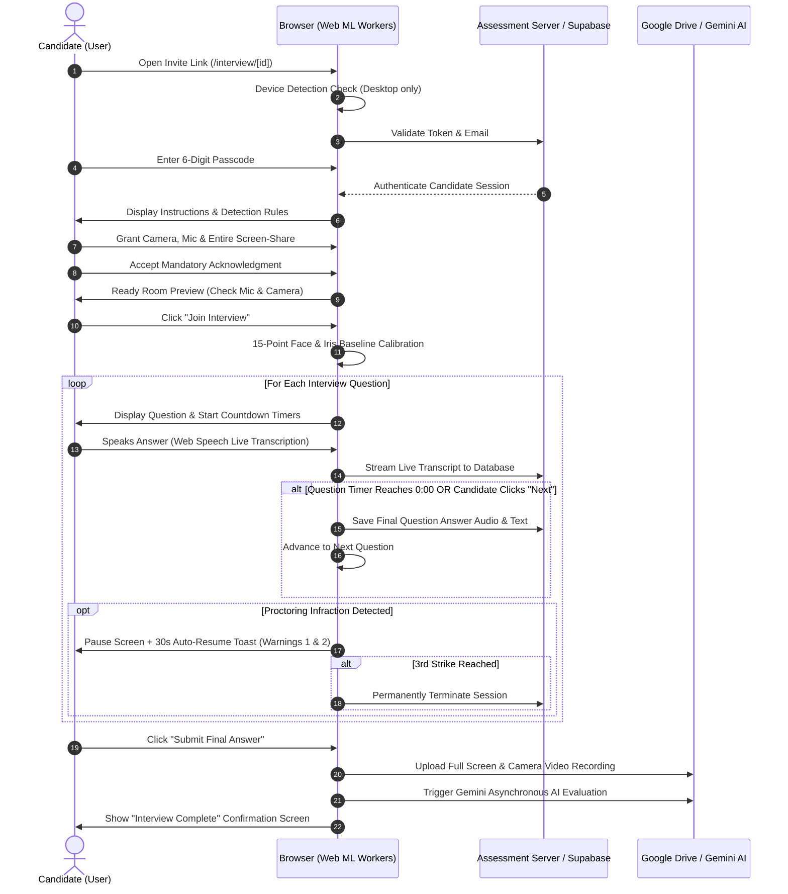

# Candidate Manual & User Guide: AI Interview Module

**Creole AI Autonomous Assessment Platform**  
*Document Version:* 2.0  
*Target Audience:* Job Candidates (Treating Candidate as the User)  
*Module Role:* Candidate Assessment Experience  

---

## Table of Contents
1. [Introduction for Candidates](#1-introduction-for-candidates)
2. [Candidate Journey Roadmap (End-to-End Flow)](#2-candidate-journey-roadmap-end-to-end-flow)
3. [Step 1: System Requirements & Device Compatibility Check](#3-step-1-system-requirements--device-compatibility-check)
4. [Step 2: Accessing the Assessment & Passcode Verification (`passcode`)](#4-step-2-accessing-the-assessment--passcode-verification-passcode)
5. [Step 3: Instructions & Hardware Permissions (`instructions` & `permissions`)](#5-step-3-instructions--hardware-permissions-instructions--permissions)
6. [Step 4: Pre-Interview Ready Room & Device Settings (`ready`)](#6-step-4-pre-interview-ready-room--device-settings-ready)
7. [Step 5: Face & Gaze Baseline Calibration (`calibration`)](#7-step-5-face--gaze-baseline-calibration-calibration)
8. [Step 6: Live Interview Room & Question Loop (`interview`)](#8-step-6-live-interview-room--question-loop-interview)
   - [Question Card & Dual Timer System](#question-card--dual-timer-system)
   - [Real-Time Voice Answer Capture & Live Transcription](#real-time-voice-answer-capture--live-transcription)
   - [Navigation: Manual 'Next Question' vs Auto-Advance](#navigation-manual-next-question-vs-auto-advance)
   - [Camera & Live Proctoring Tile](#camera--live-proctoring-tile)
   - [Live Interviewer Joining (WebRTC Mode)](#live-interviewer-joining-webrtc-mode)
9. [Step 7: Proctoring Rules, Warnings & 30-Second Auto-Resume](#9-step-7-proctoring-rules-warnings--30-second-auto-resume)
10. [Step 8: Final Submission & Video Uploading (`completed`)](#10-step-8-final-submission--video-uploading-completed)
11. [Step 9: Termination, Expiration & Re-Entry Prevention](#11-step-9-termination-expiration--re-entry-prevention)
12. [Candidate FAQ & Troubleshooting Guide](#12-candidate-faq--troubleshooting-guide)

---

## 1. Introduction for Candidates

Welcome to your AI-assisted assessment at Creole Studios. This platform is an autonomous interview environment designed to assess your technical knowledge, problem-solving skills, and verbal English communication in a fair, standardized, and unbiased format.

### What to Expect:
- You will be presented with a sequence of technical and situational questions tailored to the role.
- **You do not type your answers:** The system listens to your spoken voice, transcribes your answers in real time, and securely evaluates your responses.
- An intelligent client-side proctoring system ensures assessment integrity.
- You do not need to wait for a human proctor to begin. You can take the interview at the designated time from any quiet room.

---

## 2. Candidate Journey Roadmap (End-to-End Flow)



---

## 3. Step 1: System Requirements & Device Compatibility Check

### Device Compatibility
- **Desktop / Laptop Only**: Interviews **must** be taken on a Windows PC, Apple Mac, or Linux desktop/laptop computer.
- **Mobile & Tablet Prohibition**: If you attempt to open the interview link on a smartphone (iOS/Android) or tablet (iPad/Android tablet), the system immediately displays the `DesktopOnlyWarning` screen:
  > *"Desktop Computer Required: Assessments cannot be taken on mobile phones or tablets. Please reopen this link on a desktop or laptop computer with a functioning webcam and microphone."*

### Browser & Hardware Requirements
1. **Supported Browsers**: Google Chrome (Recommended), Microsoft Edge, Brave, or Mozilla Firefox.
2. **Functional Webcam**: Required for visual proctoring and identity verification.
3. **Working Microphone**: Required to capture your spoken answers.
4. **Stable Internet**: High-speed broadband connection (minimum 5 Mbps upload/download).

---

## 4. Step 2: Accessing the Assessment & Passcode Verification (`passcode`)

When you click your personal interview link (format: `https://portal.creolestudios.com/interview/[id]`), you enter **Stage 1: Passcode Verification**.

```
┌───────────────────────────────────────────────────┐
│                    [ Mail Icon ]                  │
│                   Join Interview                  │
│         Please enter your email to continue.      │
│                                                   │
│   Email Address *                                 │
│   [ candidate.name@example.com                  ] │
│                                                   │
│   [                 CONTINUE                    ] │
└───────────────────────────────────────────────────┘
```

### Steps:
1. **Email Identification**:
   - Enter the exact email address where you received your interview invitation.
   - Click **Continue**.
2. **6-Digit Passcode Entry**:
   - The card transitions to a passcode screen displaying your confirmed email with a convenient `Change` button.
   - Enter your unique 6-digit numerical passcode provided in your invitation email (e.g. `8 4 2 1 9 0`).
   - The system verifies the code with Supabase in the background.
3. **Single-Use Link Security**:
   - Each interview link is strictly single-use.
   - If the interview was already completed or terminated, the screen redirects to the `ExpiredInterviewLink` view displaying your session completion status.

---

## 5. Step 3: Instructions & Hardware Permissions (`instructions` & `permissions`)

Once your credentials are confirmed, you are greeted with the comprehensive **Proctoring Instructions & Permissions** interface (`proctoring-instructions.tsx`).

```
┌────────────────────────────────────────────────────────────────────────────────────────┐
│  [✓] Before you begin                           [ 🛡 Active AI Proctoring ]           │
│  Please read the instructions below, then grant the required permissions.               │
├───────────────────────────────────────────┬────────────────────────────────────────────┤
│  PROCTORING RULES                         │  REQUIRED HARDWARE PERMISSIONS             │
│                                           │                                            │
│  👁 Face & Gaze Tracking                  │  [📷 Camera]        Access Allowed  [✓]    │
│  Keep eyes centered on the screen.        │                                            │
│                                           │  [🎤 Microphone]    Access Allowed  [✓]    │
│  📱 Object Detection                      │                                            │
│  No phones, notes, earbuds, or headsets.  │  [🖥 Screen Share]  Entire Screen   [✓]    │
│                                           │                                            │
│  🎙 Voice Guard                           │  ----------------------------------------  │
│  No second voices or background helpers.  │                                            │
│                                           │  [  Allow Camera, Mic & Screen Share   ]   │
│  ⚠️ 3-Warning Termination Policy          │                                            │
│  3 strikes = instant session termination. │                                            │
└───────────────────────────────────────────┴────────────────────────────────────────────┘
```

### Permissions Candidate Must Grant:
1. **Camera Permission**: Allows the assessment window to monitor your video feed.
2. **Microphone Permission**: Captures your verbal answers and evaluates speech clarity.
3. **Entire Screen Share (`getDisplayMedia`)**:
   - **Crucial Step**: You must choose **"Entire Screen"** (not just a single browser tab or window) and check the **"Share system audio"** option if prompted.
   - This ensures full integrity and proves no third-party communication tools or AI cheat sheets are being used.

### Mandatory Candidate Acknowledgment Modal:
Before moving forward, an acknowledgment dialog appears:
- You must check the box:
  > *"I acknowledge that I have read the instructions, understand the proctoring rules, and have granted all required permissions."*
- Click **"Next"** to enter the Ready Room.

---

## 6. Step 4: Pre-Interview Ready Room & Device Settings (`ready`)

The **Ready Room** (`stage === 'ready'`) acts as your pre-flight cockpit.

```
┌─────────────────────────────────────────────────────────┐
│                    [ Shield Icon ]                      │
│                   You're Verified                       │
│    Your camera, mic, and screen share are live.         │
│                                                         │
│   ┌─────────────────────────────────────────────────┐   │
│   │                                                 │   │
│   │           [ LIVE WEBCAM VIDEO PREVIEW ]         │   │
│   │                                                 │   │
│   └─────────────────────────────────────────────────┘   │
│                                                         │
│   [ 🎤 Mute / Unmute ]   [ ⚙ Device Settings ]         │
│                                                         │
│   [              JOIN INTERVIEW                     ]   │
└─────────────────────────────────────────────────────────┘
```

### Ready Room Controls:
1. **Video Preview Tile (`MeetingVideoTile`)**:
   - Confirms your camera is framed correctly with proper lighting.
2. **Audio Indicator & Mute Toggle (`MeetingControlBar`)**:
   - Speak a few words; observe the microphone indicator responding to your voice.
3. **Device Settings Panel (`DeviceSettingsPanel.tsx`)**:
   - Click the gear icon (`⚙`) if you need to switch between integrated webcams or external USB microphones.
4. **Bluetooth / Headset Notification**:
   - If an approved headset is connected, an indicator appears. (Standard mobile earbuds/AirPods remain strictly prohibited).
5. **Continuous Screen-Share Verification**:
   - If your screen share drops or is accidentally stopped, the **"Join Interview"** button automatically disables and warns you to re-enable sharing.
6. **Initiation**:
   - When ready, click the bright cyan **"Join Interview"** button.

---

## 7. Step 5: Face & Gaze Baseline Calibration (`calibration`)

Before the first question appears, the platform calibrates its visual AI to your unique natural posture (`CalibrationModal.tsx`).

### How Calibration Works:
1. A visual target indicator appears on screen.
2. You are asked to sit naturally and look directly at the center of your screen.
3. The background MediaPipe FaceMesh model captures **15 baseline spatial samples**:
   - Natural resting iris coordinates (left and right eyes).
   - Natural head yaw and pitch angles.
4. **Why this matters for you:** Calibration prevents false warnings. If your webcam is positioned slightly above or below your monitor, the AI learns your setup so natural reading does not trigger false gaze infractions.
5. The calibration progress reaches 100% in ~2 seconds, and the live interview room opens automatically.

---

## 8. Step 6: Live Interview Room & Question Loop (`interview`)

Once calibrated, you enter the primary live interview interface.

```
┌─────────────────────────────────────────────────────────────────┬────────────────────────┐
│  QUESTION CARD                                                  │ CAMERA & PROCTORING    │
│                                                                 │                        │
│  Question 1 of 5           [Total: 14:32]  [Question: 01:54]    │ ┌────────────────────┐ │
│  Difficulty: Medium        Category: React Architecture         │ │                    │ │
│                                                                 │ │  [LIVE WEBCAM TILE]│ │
│  How would you design a scalable state management architecture │ │                    │ │
│  in Next.js 15 App Router when sharing data between server     │ └────────────────────┘ │
│  and client components?                                         │  ● Face detected       │
│                                                                 │  🎤 Mic Active         │
│  🔴 Recording your voice   •  Answer saved in real time         │                        │
│                                                                 │  [ 🎤 Mic Toggle ]    │
│  ┌───────────────────────────────────────────────────────────┐  │                        │
│  │ Your Answer (Transcribed in real time):                   │  │                        │
│  │ "In Next.js 15, I would leverage React Server Components  │  │                        │
│  │ for direct database queries and pass immutable props..."  │  │                        │
│  └───────────────────────────────────────────────────────────┘  │                        │
│                                                                 │                        │
│  [                                       Next Question ➔ ]      │                        │
└─────────────────────────────────────────────────────────────────┴────────────────────────┘
```

### Key Elements of the Live Room:

#### Question Card & Dual Timer System
- **Category & Difficulty**: Clearly states the topic (e.g., `TypeScript`, `Database Design`) and difficulty level.
- **Overall Session Timer** (`Total: MM:SS`): Shows total interview time remaining (e.g., 15 minutes). Changes from neutral to orange at 10 minutes, and pulses red in the final 60 seconds.
- **Per-Question Countdown Timer** (`Question: MM:SS`): Shows time allotted for this specific question (typically 2 to 3 minutes). Pulses red when under 30 seconds.

#### Real-Time Voice Answer Capture & Live Transcription
- **Hands-Free Speaking**: As soon as a question loads, your microphone is active.
- **Live Transcription**: The Web Speech engine transcribes your words live into the blue answer box on screen.
- **Interim Speech Feedback**: Words currently being spoken appear in real-time italicized text before settling into confirmed sentences.
- **Real-Time Database Persistence**: Every sentence you speak is continuously saved to the backend database (`"Answer saved in real time"`). Even if your network stutters, your spoken words are not lost.

#### Navigation: Manual 'Next Question' vs Auto-Advance
- **Spoken Answer Requirement**: To prevent accidental skipping, the **"Next Question"** button remains disabled until you speak at least one sentence.
- **Advancing Manually**: Once you finish speaking your answer, click **"Next Question"** (or **"Submit Final Answer"** on the last question).
- **Advancing Automatically**: If the question countdown timer reaches `00:00`, the system automatically captures whatever you have spoken so far and seamlessly advances to the next question.

#### Camera & Live Proctoring Tile
- **Mirror Self-Preview**: The sticky right-hand panel displays your webcam feed so you can confirm you remain centered.
- **Status Indicator**:
  - `Face detected` (pulsing green dot): Everything is optimal.
  - `No face detected` (amber dot): You have moved out of the camera frame.
- **Microphone Status**: Confirms your microphone is capturing clear sound.

#### Live Interviewer Joining (WebRTC Mode)
- In certain scheduled sessions, a Creole Studios HR manager or Technical Lead may connect directly to your live room via WebRTC.
- When an interviewer joins:
  - An additional video tile labeled **"Interviewer"** automatically appears above your self-view tile.
  - You will be able to see and hear the interviewer in real time alongside the automated AI questions.

---

## 9. Step 7: Proctoring Rules, Warnings & 30-Second Auto-Resume

The interview runs client-side machine learning models in background browser workers to monitor session integrity.

### Active Detection Rules:
1. **Face Tracking (MediaPipe)**: Flags looking away from the screen for extended periods, turning your head, leaving the frame, or having a second person in view.
2. **Object Detection (COCO-SSD)**: Actively detects smartphones, books, notepads, unauthorized headphones, and extra screens.
3. **Voice Guard (Web Audio Analyser)**: Detects third-party voices assisting in the background.
4. **Tab & Window Guard**: Detects switching browser tabs, opening other applications, or minimizing the window.

### The Unified 3-Warning Termination Policy:
All proctoring infractions feed into a single unified counter:

```
Violation Detected
        │
   Strike 1 or 2 ──────► Screen Pauses + Blurs
        │                Amber Warning Toast appears with violation reason
        │                30-Second Auto-Resume Countdown starts
        │                [ Candidate can click "Resume Interview" OR waits 30s ]
        │
   Strike 3 ───────────► PERMANENT TERMINATION
                         Red Warning Banner
                         Session locked immediately. No re-entry permitted.
```

#### What Happens During Warning 1 & Warning 2:
- The screen blurs to protect assessment content.
- An amber alert toast banner appears at the top:
  > *"Warning 1 of 3: Cell phone detected in camera frame."*  
  > *"Candidate paused. Auto-resumes in 30s if not clicked."*
- **How to Resume**: Correct the issue immediately (e.g. put your phone away, center your face) and click **"Resume Interview"**. If you do not click within 30 seconds, the session resumes automatically so you do not lose interview time.

#### Warning 3: Immediate Auto-Termination:
- If a 3rd infraction occurs, no resume option is provided.
- The session is terminated permanently.

---

## 10. Step 8: Final Submission & Video Uploading (`completed`)

When you submit your answer to the final question (or when the overall session timer expires), the system enters the finalization stage.

```
┌─────────────────────────────────────────────────────────────┐
│                      [ Upload Cloud ]                       │
│                   Finalizing Assessment                     │
│    Please wait until your assessment gets completely        │
│    finished. Do not close or refresh this tab while         │
│    submission finalizes.                                    │
│                                                             │
│    [ ▓▓▓▓▓▓▓▓▓▓▓▓▓▓▓▓▓▓▓▓▓▓▓▓▓▓▓▓▓▓░░░░░░░░░░░░░░ ]  68%    │
│    Uploading full session video recording...                │
└─────────────────────────────────────────────────────────────┘
```

### Finalization Steps:
1. **Full Video Upload (`#full-video-upload-modal`)**:
   - The platform packages the complete continuous screen, webcam, and audio recording and streams it securely to Google Drive.
   - A live progress bar displays completion percentage (`0%` to `100%`).
   - **Crucial:** Do not close, reload, or navigate away from the browser tab while this modal is active.
2. **AI Evaluation Trigger**:
   - The system triggers Gemini Flash AI to analyze your transcript for technical correctness, problem-solving depth, and CEFR English fluency.
3. **Confirmation Screen**:
   - The screen transitions to a clean green completion card:
     > *"Interview complete. Thank you. Your assessment has been submitted. You may close this window now."*

---

## 11. Step 9: Termination, Expiration & Re-Entry Prevention

### Terminated Sessions (`stage === 'terminated'`)
If an interview is terminated due to 3 proctoring strikes, unauthorized page refreshing during live assessment, or tab switching:
- The `TerminatedInterview` screen renders.
- Displays the exact infraction reason recorded in the audit logs.
- The candidate cannot restart or re-enter the session.

### Expired Links (`stage === 'expired'`)
If a candidate attempts to open an interview link after submission:
- The `ExpiredInterviewLink` component renders:
  > *"Link is expired: This link is single-use. Your interview has been submitted and our talent acquisition team will review your results."*

---

## 12. Candidate FAQ, Test Diagnostics & Comprehensive Troubleshooting Guide

### 12.1 Test Stage Diagnostics & Resolution Matrix

| Stage | What Can Go Wrong / Error Message | Root Cause | Immediate Candidate / Tester Action |
| :--- | :--- | :--- | :--- |
| **0. Entry / Mobile** | *"Desktop Computer Required"* | Candidate is accessing via iPhone, Android, or tablet | **Action**: You cannot bypass this check. Move to a laptop or desktop PC (Windows, macOS, or Linux) with Chrome/Edge. |
| **1. Passcode** | *"Invalid passcode or email does not match"* | Typo in email or 6-digit access code | **Action**: Click "Change" email to verify correct spelling. Ensure code matches the invitation email. Check for leading/trailing spaces. |
| **1. Passcode** | *"This interview link has already been used and is expired"* | Session was already completed or terminated in a previous attempt | **Action**: Sessions are single-use. If this was premature, contact your HR coordinator to generate a new assessment token. |
| **2. Permissions** | *"Permission denied"* on Camera or Mic | Browser blocked permissions or hardware is locked by Zoom/Teams/Meet | **Action**: 1. Close Zoom, Google Meet, Teams, or Skype.<br>2. Click the padlock icon in the browser URL bar → Set Camera and Microphone to **"Allow"**.<br>3. Refresh the permissions stage. |
| **2. Permissions** | *"Screen share was stopped. Please re-enable screen sharing"* | Candidate shared only a window/tab instead of the whole screen, or clicked "Stop Sharing" | **Action**: You **must** select **"Entire Screen"**. Do not select a specific application window or single tab. Click *"Allow & Start Interview"* to restart stream. |
| **3. Ready Room** | Video preview is black or static | Webcam driver busy or wrong device selected | **Action**: Click the **Device Settings (`⚙`)** icon on the control bar. Select your active webcam from the dropdown and click *Apply*. |
| **3. Ready Room** | *"Screen share was stopped"* banner | Screen stream tracks became inactive | **Action**: Re-click *"Allow Camera, Mic & Screen Share"* to restore the display stream before the *"Join Interview"* button can enable. |
| **4. Calibration** | Calibration hangs at 0% or does not advance | MediaPipe FaceMesh web worker failed to load or face not detected | **Action**: Ensure face is centered, well-lit from the front, and within 2–3 feet of the webcam. Look directly at the center target dot. |
| **5. Live Question** | Speech is not appearing in the transcription box | Microphone muted in browser or Web Speech API unresponsive | **Action**: 1. Check the microphone status badge.<br>2. Click the Mic Toggle button twice (mute then unmute) to re-initialize Web Speech recognition.<br>3. Speak in a clear, conversational voice. |
| **5. Live Question** | *"Next question"* button is disabled | System requires at least 1 spoken sentence before allowing progression | **Action**: Speak your verbal answer. The transcription box will populate and the button will automatically unlock. |
| **5. Live Question** | Per-question timer hits `0:00` | Time allotted for this question expired | **Action**: No action needed. The system automatically saves whatever you spoke and transitions to the next question. |
| **6. Proctoring** | Amber warning banner: *"Warning 1 of 3: Cell phone detected"* | Phone, notebook, earphone, or extra monitor in camera field | **Action**: Immediately remove the item from view. Click the **"Resume Interview"** button (or wait for the 30-second countdown to auto-resume). |
| **6. Proctoring** | Amber warning banner: *"Warning 2 of 3: Looking away from screen"* | Candidate looking off-screen for extended duration | **Action**: Re-center your head and keep eyes on the screen. Click **"Resume Interview"**. Remember: 3 strikes will permanently terminate the session! |
| **7. Final Upload** | Upload progress bar stops at 90% or hangs | Full continuous video recording buffer being finalized to Google Drive | **Action**: **DO NOT REFRESH OR CLOSE THE TAB.** Large video recordings (100MB+) take 10–30 seconds to stream. The page will auto-complete once the server confirms. |
| **8. Completion** | Page refreshed accidentally after finishing | Session marked completed in database | **Action**: This is normal. Your answers and recordings have already been committed to the server. You may close your browser. |

### 12.2 Frequently Asked Questions (FAQ)

#### Q1: Can I use wireless AirPods or Bluetooth headphones?
**Answer**: Wireless AirPods, earbuds, and over-ear entertainment headphones are strictly prohibited and will trigger an immediate proctoring violation. If an approved USB headset is used, ensure it is recognized during device selection.

#### Q2: What happens if my Wi-Fi drops momentarily during the interview?
**Answer**: The Creole assessment engine caches transcription text and continuous video chunks locally in browser memory. Once connection stabilizes, the queue flushes automatically. Do not close or reload the page.

#### Q3: How do the dual timers work?
**Answer**: 
- **Total Session Timer** (e.g. 15 minutes): Tracks the entire interview duration. If this expires, all current answers are submitted and the interview finishes.
- **Question Countdown Timer** (e.g. 120s): Tracks the time limit for the active question. When it reaches `0:00`, it automatically saves your spoken answer and moves to the next question.

#### Q4: Can I skip or return to a previous question?
**Answer**: No. To preserve assessment standardization, questions must be answered sequentially and cannot be modified once advanced.


