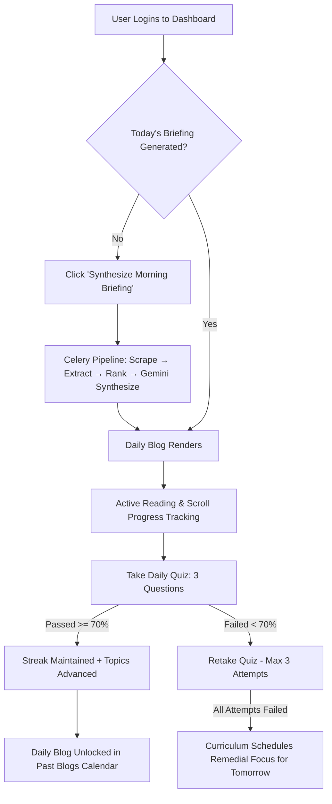

# User Manual & Step-by-Step Guide: Blog Fetch Module

**Creole Knowledge Portal — Automated Tech Digest & Continuous Learning System**  
*Document Version:* 2.0  
*Target Audience:* Portal Users (Engineers, Team Members, Authors, and Admins)  
*Module Role:* Internal User / Employee Experience  

---

## Table of Contents
1. [Overview & Architectural Philosophy](#1-overview--architectural-philosophy)
2. [User Prerequisites & Authentication](#2-user-prerequisites--authentication)
3. [Global Layout & Navigation System](#3-global-layout--navigation-system)
4. [Tab 1: Daily Blog (Core Learning Journey)](#4-tab-1-daily-blog-core-learning-journey)
   - [State A: Empty / Unsynthesized State](#state-a-empty--unsynthesized-state)
   - [State B: Live Pipeline Synthesis State](#state-b-live-pipeline-synthesis-state)
   - [State C: Today's Briefing Reader](#state-c-todays-briefing-reader)
   - [State D: Daily Verification Quiz Loop](#state-d-daily-verification-quiz-loop)
5. [Tab 2: Past Blogs (Historical Archive & Calendar)](#5-tab-2-past-blogs-historical-archive--calendar)
6. [Tab 3: Activity Tracker (Reading Analytics & Logs)](#6-tab-3-activity-tracker-reading-analytics--logs)
7. [Tab 4: Leaderboard (Peer Ranking & Milestones)](#7-tab-4-leaderboard-peer-ranking--milestones)
8. [Tab 5: Blog Roulette (Authoring & Publishing Flow)](#8-tab-5-blog-roulette-authoring--publishing-flow)
9. [Error Handling, Quotas & Troubleshooting](#9-error-handling-quotas--troubleshooting)

---

## 1. Overview & Architectural Philosophy

The **Blog Fetch Module** inside the Creole Knowledge Portal delivers personalized, high-value technical intelligence directly to each engineer every calendar day. Rather than overwhelming users with raw RSS links or superficial news summaries, the system functions as a personalized learning engine:

1. **Intelligent Web Discovery**: Crawls developer-centric platforms (Dev.to, Hacker News, verified engineering RSS feeds).
2. **Context-Aware Ranking**: Analyzes each user's primary/secondary tech stack, designated learning interests, and previous quiz performance.
3. **Deep Synthesis (Gemini Flash)**: Generates a comprehensive, pedagogical 20–25 minute long-form briefing (~4,500 words) complete with architectural breakdowns, practical code implementations, key takeaways, and source citations.
4. **Knowledge Retention Loop**: Pairs each daily briefing with an adaptive 3-question retention quiz that feeds directly back into tomorrow's curriculum.



---

## 2. User Prerequisites & Authentication

### How to Access
1. Open the Creole Knowledge Portal in any modern web browser (`https://portal.creolestudios.com` or local `http://localhost:3000`).
2. Sign in with your corporate Google SSO or email credentials authenticated via Supabase Auth.
3. Upon first login, users configure their **Tech Stack & Learning Profile** (e.g., Primary Stack: `React, TypeScript, Next.js`, Interests: `AI Agents, System Architecture`).
4. You are routed to the central hub at `/dashboard`.

---

## 3. Global Layout & Navigation System

The portal utilizes a unified `DashboardShell` layout featuring a sticky desktop sidebar (collapsible slide-out drawer on mobile screens) and a top context bar.

```
┌───────────────────────────┬────────────────────────────────────────────────────────┐
│  CREOLE PORTAL            │ [≡] Top Bar              user@creolestudios.com [User] │
├───────────────────────────┼────────────────────────────────────────────────────────┤
│  [📰] Daily Blog          │                                                        │
│  [🕒] Past Blogs           │  [ Reading Progress Indicator: ▓▓▓▓▓▓▓▓▓▓░░░░░  65% ]  │
│  [📊] Activity Tracker    │                                                        │
│  [🏆] Leaderboard         │  Active Tab Workspace Content                          │
│  [✨] Blog Roulette        │  (Renders whichever tab is selected)                   │
├───────────────────────────┤                                                        │
│  🔥 5 days Reading Streak │                                                        │
│  [Weekly Activity Mini-Bar]│                                                       │
├───────────────────────────┤                                                        │
│  [⎋ Sign Out]             │                                                        │
└───────────────────────────┴────────────────────────────────────────────────────────┘
```

### Key Elements of the Global Frame:
1. **Vertical Tab Navigation**:
   - `Daily Blog` (`/dashboard`): Today's briefing, reading timer, and verification quiz.
   - `Past Blogs` (`/dashboard?tab=past`): Interactive monthly calendar archive.
   - `Activity Tracker` (`/dashboard?tab=activity`): Granular breakdown of reading seconds, quiz scores, and daily logs.
   - `Leaderboard` (`/dashboard?tab=leaderboard`): Company-wide peer standing based on reading duration and quiz accuracy.
   - `Blog Roulette` (`/blog-roulette`): Contributor workspace for authoring and vetting internal engineering blogs.
2. **Reading Streak Badge (`Flame` icon)**:
   - Displays consecutive days where both reading and the daily quiz have been completed.
   - Synchronized server-side using IST timezone (`Asia/Kolkata`) so daily resets occur consistently at midnight IST.
3. **Weekly Activity Mini-Widget**:
   - Displays 7 micro-bars representing Monday through Sunday of the current week.
   - Shows at-a-glance status: Active reading time (height of bar) and quiz completion status (green indicator).
4. **Top Reading Progress Bar**:
   - A reactive progress bar mounted along the bottom edge of the top navigation header.
   - Dynamically tracks vertical scroll position through the active briefing from 0% to 100%.

---

## 4. Tab 1: Daily Blog (Core Learning Journey)

The **Daily Blog** tab (`components/dashboard/DailyBlogTab.tsx`) is the heart of the learning experience. It dynamically renders one of several states depending on the current time and pipeline progress.

### State A: Empty / Unsynthesized State
If no briefing has been generated for today's IST date:
- **Visual Presentation**: A dark gradient card displaying a glowing `Sparkles` icon with the headline:
  > *"Your Daily Tech Briefing is Ready."*  
  > *"No briefing for today yet. Synthesize once to generate this morning's article."*
- **Primary CTA**: **"Synthesize Morning Briefing"** button.

### State B: Live Pipeline Synthesis State
When the user clicks the "Synthesize Morning Briefing" button:
1. The button changes into an animated loading spinner.
2. The user sees a real-time progress status carousel displaying the 6 automated backend stages:
   - *"Syncing your preferences into the pipeline..."*
   - *"Scraping Dev.to, Hacker News, and RSS for your stack..."*
   - *"Extracting article bodies..."*
   - *"Re-ranking matches with Gemini..."*
   - *"Writing a 20-25 minute briefing from your sources..."*
   - *"Saving the digest to MongoDB..."*
3. Once completed, the card seamlessly transitions to reveal the synthesized briefing without requiring a manual page refresh.

### State C: Today's Briefing Reader
When a valid briefing exists for today:
1. **Header Metadata**:
   - **Date Chip**: Displays `Today` or formatted IST date.
   - **Reading Time Badge**: Displays estimated reading time (e.g., `22 min read` computed at ~180 words/minute).
   - **Curator & Persona**: Displays the user's role and tailored topics.
2. **Article Body (`PremiumMarkdownRenderer`)**:
   - **Interactive Table of Contents**: Floating anchor links to jump straight into chapters.
   - **Pedagogical Structure**:
     - *Executive Summary / TL;DR*: Key conceptual highlights.
     - *Deep-Dive Teaching Chapters*: In-depth architecture explanations.
     - *Practical Code Implementations*: Syntax-highlighted code blocks with 1-click copy functionality.
     - *Architectural Diagrams*: Rendered Mermaid and ASCII flowcharts.
     - *Actionable Takeaways*: Bulleted checklist of engineering practices.
3. **Curation Context & Sources Sidebar**:
   - **Curation Focus**: Badges showing specific topics covered (e.g., `FastAPI`, `Celery`, `Redis Streams`, `AsyncIO`).
   - **Network Context (Sources Evaluated)**: Clickable external cards linking back to the original developer articles and blogs used as factual references.
4. **Active Reading Timer Watchdog**:
   - Tracks authentic time spent on the page.
   - Silently pauses when the tab loses focus or when the user is idle, ensuring genuine engagement logging.

### State D: Daily Verification Quiz Loop
At the conclusion of the article, the candidate encounters the **Interactive Quiz Gate**:

```
┌────────────────────────────────────────────────────────────────────────┐
│                   DAILY KNOWLEDGE CHECK                                │
│                                                                        │
│   [ Start Quiz — Attempt 1 of 3 (3 attempts left) ]                   │
│                                                                        │
│   • 3 deep architectural questions generated from today's text         │
│   • Passing threshold: 70% or higher                                   │
│   • Results adapt tomorrow's briefing topics automatically             │
└────────────────────────────────────────────────────────────────────────┘
```

#### Quiz Interaction Steps:
1. **Initiation**: Click **"Start Quiz — Attempt 1 of 3"**.
2. **Modal Experience (`QuizModal.tsx`)**:
   - Presents 3 multi-choice questions testing comprehension, not just surface memorization.
   - Each option displays clear code snippets or theoretical explanations.
3. **Instant Feedback**:
   - Displays correct answers, explanations, and score breakdown (e.g., `3/3 pts • 100%`).
4. **Outcomes & Next Steps**:
   - **Passed (>= 70%)**:
     - Renders celebratory green badge: `Quiz Passed! (3/3 pts • 100%) 🎉`.
     - Maintains reading streak.
     - Unlocks the briefing in the **Past Blogs** calendar.
     - Provides a **"Review Quiz Results"** button to re-inspect explanations anytime.
   - **Failed (< 70%)**:
     - Displays remaining attempts (e.g., `Attempt 1 of 3 completed • 2 attempts left`).
     - Renders **"Retake Quiz — Attempt 2 of 3"**.
     - If all 3 attempts are exhausted: Status locks into `Quiz Failed (Max Attempts Reached) ❌`. Tomorrow's scrape pipeline automatically tags these weak topics for foundational reinforcement.

---

## 5. Tab 2: Past Blogs (Historical Archive & Calendar)

The **Past Blogs** tab (`components/dashboard/PastBlogsTab.tsx`) enables users to revisit any historical briefing, review architectural patterns, or catch up on missed reading.

### Calendar View Layout:
- **Month/Year Navigator**: Switch between previous and current months.
- **Color-Coded Day Cells**:
  - **Green Indicator**: Briefing was read and the daily quiz was successfully completed.
  - **Red Indicator**: Briefing was generated, but the daily quiz was missed or failed.
  - **Muted / Gray**: Weekend, company holiday, or no briefing scheduled.
  - **Highlighted Ring**: Currently selected date.

### Same-Day Security Lock Rule:
> **Important Rule:** To maintain learning integrity, **today's briefing remains locked in the Past Blogs calendar** until the user completes today's quiz in the Daily Blog tab. Once completed, today's entry immediately unlocks in the archive.

### Reading a Past Article:
- Clicking any active date instantly renders the full historical article in the right-hand preview panel.
- Users can review the full markdown, code snippets, and original source citations at their own pace.

---

## 6. Tab 3: Activity Tracker (Reading Analytics & Logs)

The **Activity Tracker** tab (`components/dashboard/ActivityTab.tsx`) gives users full visibility into their personal growth metrics.

### Key Components:
1. **Streak Banner**:
   - Displays current uninterrupted streak days with motivational encouragement (`Flame` banner).
2. **Daily Activity Log Table**:
   - Chronological table displaying daily records:
     - **Date**: Formatted calendar day (e.g., `Mon, Oct 19`).
     - **Read Time**: Total authentic active reading duration (e.g., `21m 45s`).
     - **Quiz Status**: Visual badges (`Passed`, `Failed`, `In Progress`, or `Unattempted`).
     - **Correct Points**: Exact points and percentage breakdown (e.g., `3 / 3 (100%)`).
3. **Granular Attempt Inspection**:
   - Expanding a row displays individual scores across all 3 quiz attempts for that day.

---

## 7. Tab 4: Leaderboard (Peer Ranking & Milestones)

The **Leaderboard** tab (`components/dashboard/LeaderboardTab.tsx`) fosters healthy engineering habits through transparent peer recognition.

### Rankings Table Features:
- **Top 3 Medal Trophies**:
  - 🥇 **Rank 1**: Gold Medal badge.
  - 🥈 **Rank 2**: Silver Medal badge.
  - 🥉 **Rank 3**: Bronze Medal badge.
  - Ranks 4+: Numeric position rank.
- **User Identifier**: Email handle, domain, and role badge (e.g., `Frontend Engineer`, `Fullstack Developer`).
- **Cumulative Reading Time**: Aggregated hours and minutes spent actively learning.
- **Cumulative Quiz Score**: Total verified points scored across daily quizzes.

---

## 8. Tab 5: Blog Roulette (Authoring & Publishing Flow)

Clicking **Blog Roulette** (`/blog-roulette`) transitions the user from an intelligence consumer into an active engineering contributor.

### Contributor Step-by-Step Flow:
1. **Topic & SEO Initialization**:
   - Enter proposed title → System queries Google Autocomplete/Trends to suggest high-impact keywords.
2. **Drafting Environment**:
   - High-fidelity Markdown/Rich-Text editor.
   - Real-time sidebar checklist: Word count gauge, code block count, architecture diagram validator.
3. **AI Quality Vetting Quiz**:
   - To verify human authorship and prevent copy-pasting unvetted LLM output, an AI agent generates 3 deep vetting questions about the author's own draft.
   - The author must pass their own draft's quiz to prove technical mastery.
4. **One-Click Publishing to Google Drive**:
   - Automatically converts the approved markdown/HTML into a native Google Doc in the Marketing Team's shared drive for final proofreading and publishing.

---

## 9. Error Handling, Testing & Troubleshooting Guide

### 9.1 Stage-by-Stage Diagnostics Matrix

| Stage / Component | Symptom / Error Message | Root Cause | Operator / Developer Troubleshooting Steps |
| :--- | :--- | :--- | :--- |
| **Authentication & Profile** | *"Loading your portal..."* infinite spinner | Supabase session token expired or PostgREST timeout | 1. Check browser LocalStorage / Cookies for `sb-access-token`.<br>2. Test Supabase reachability: `curl -I https://<project>.supabase.co/rest/v1/`.<br>3. Relogin via `/` login screen. |
| **Profile Sync** | Preferences not reflected in scrape | `user_profiles` sync between Supabase and MongoDB delayed | 1. Manually trigger profile sync: `curl -X POST http://localhost:8000/api/v1/profiles/<userId>/sync -H "X-Internal-Token: <AUTH_SECRET_KEY>"`.<br>2. Inspect MongoDB: `db.user_profiles.findOne({ user_id: "<userId>" })`. |
| **Synthesis Button** | *"Today's briefing was not generated (HTTP 503)"* | Celery workers not running or Redis broker queue stalled | 1. Verify Redis is running: `docker compose ps` (Port 6379).<br>2. Start Celery workers: `powershell -File scripts/start-workers.ps1` (or run solo pool command in `fetch-blogs/README.md`).<br>3. Check Celery Flower dashboard at `http://localhost:5555`. |
| **Synthesis Button** | *"Gemini API quota exceeded (HTTP 429)"* | Gemini API tier rate limit reached | 1. The microservice automatically cycles across fallback models (`gemini-3.6-flash` → `gemini-3.5-flash` → `gemini-2.5-flash`).<br>2. If all quotas exhausted, wait for midnight UTC quota reset or update `LLM_GEMINI_API_KEY` in `.env`. |
| **Synthesis Button** | *"Could not reach the briefing service"* | FastAPI microservice on `:8000` is offline | 1. Check FastAPI health: `curl http://localhost:8000/api/v1/health`.<br>2. Restart backend: `cd fetch-blogs && uv run fastapi dev src/main.py`. |
| **Daily Blog Reader** | Blank screen or unrendered Markdown | Malformed AST from synthesis LLM | 1. Check browser DevTools console for `PremiumMarkdownRenderer` parsing errors.<br>2. The renderer isolates erroneous code blocks and renders fallback raw text to prevent crashing. |
| **Reading Timer** | Reading duration stays at `0s` | Tab unfocused or browser background throttling | 1. Reading timer automatically pauses if the browser window loses focus to prevent fake time inflation.<br>2. Ensure active interaction/scrolling inside the briefing container. |
| **Daily Quiz Gate** | *"Opening Quiz..."* spinner hangs | `/api/quiz` endpoint failed to generate questions | 1. Check Next.js server logs for `/api/quiz/generate`.<br>2. Verify quiz questions exist in database: query Supabase `daily_quizzes` table for `blog_id`. |
| **Daily Quiz Gate** | Quiz retake disabled after 3 attempts | Enforcement of 3-attempt daily ceiling | 1. By architectural design, max 3 attempts are permitted per day.<br>2. Review explanations using **"Review Quiz Results"**. Uncovered topics are pushed into tomorrow's curriculum. |
| **Past Blogs Tab** | Today's briefing greyed out on calendar | Same-Day Quiz Lockout Policy | 1. This is expected behavior. Complete the quiz on the **Daily Blog** tab to unlock today's entry in the archive. |

### 9.2 Microservice CLI Diagnostic Commands
When testing or debugging the Blog Fetch pipeline locally:

```bash
# 1. Health check probes
curl http://localhost:8000/api/v1/health
curl http://localhost:8000/api/v1/health/ready

# 2. Inspect active pipeline job status
curl http://localhost:8000/api/v1/pipeline/status/<userId>

# 3. Trigger manual digest generation via CLI
curl -X POST http://localhost:8000/api/v1/digests/generate \
  -H "Content-Type: application/json" \
  -d '{"userId": "<supabase-user-uuid>"}'

# 4. Run automated test suite
cd fetch-blogs
uv run pytest --cov=src -v
```

---
*Manual compiled by Creole Knowledge Portal Engineering Team.*

